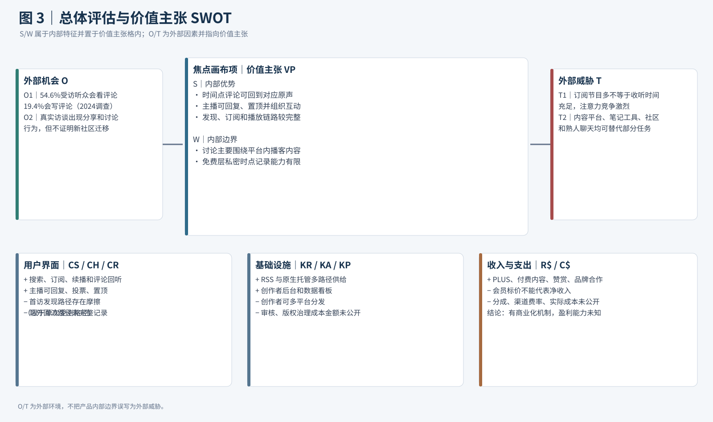
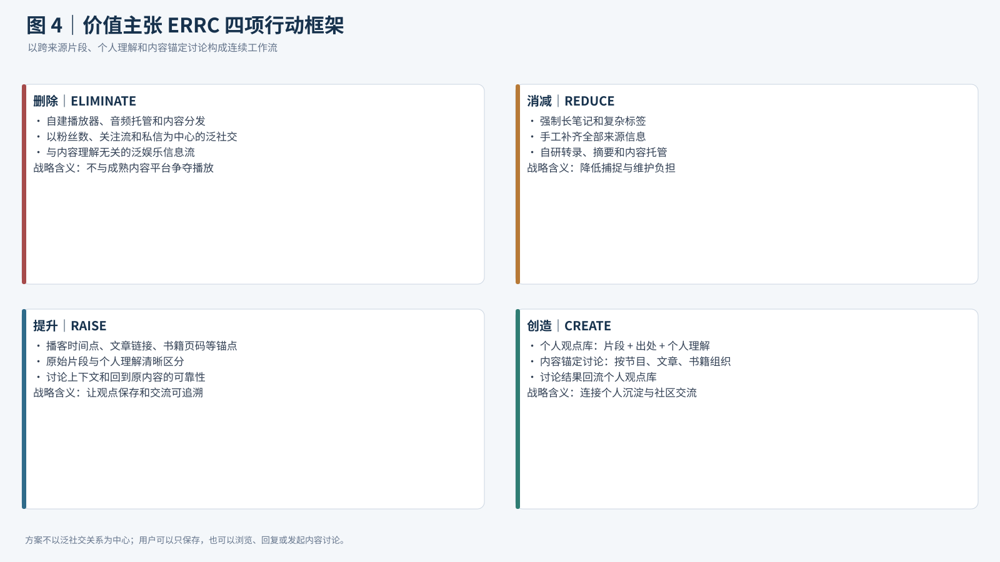

# 深度内容思考与共鸣社区：竞品选择与商业模式评估报告

> 课程作业整合稿 v0.6｜引用与证据修订版
>
> 日期：2026-11-16｜负责人：M1
>
> 焦点竞品：小宇宙
>
> 研究范围：深度内容消费后的片段捕捉、出处保留、个人理解、检索回顾与内容锚定讨论。

## 摘要

播客、书籍和长文章中的一个具体片段，可能触发用户的共鸣、疑问或新的理解。用户随后可能想保存片段、保留出处、记下自己的想法，过一段时间再找回来；也可能希望把观点带给朋友，或围绕同一内容与其他读者交流。这些行为目前分散在内容平台收藏和评论、截图、个人笔记以及即时通信工具中。市场并不缺少收藏、批注和评论功能，真正值得研究的是这些功能之间的衔接成本。

团队完成了 8 份真实访谈、16 份 AI 模拟访谈、十款代表产品的竞品研究，以及小宇宙商业模式和外部环境分析。真实访谈呈现了保存、分享、回找和讨论行为，也包含现有工具足够、不愿额外安装应用以及不愿公开表达等反向证据。AI 模拟仅用于探索反例，不计入真实样本。竞品研究表明，片段捕捉、出处定位、个人笔记和作品讨论均已有产品覆盖，不能把任何单项功能描述成市场空白。

本报告选择小宇宙作为课程焦点竞品，因为它连接播客发现、收听、时间点评论、原声回听、主播互动和创作者运营，能够展示深度内容消费场景中的多边商业模式。报告完成其九模块商业模式画布、四部分总体评估、价值主张 SWOT、商业模式环境 18 项分析，以及价值主张方向的 ERRC 和新商业模式画布。

本组提出的产品由两个相互连接的空间构成：**个人观点库**负责保存内容片段、出处和个人理解，并支持检索回看；**内容锚定讨论空间**围绕播客单集、文章或书籍组织交流，每条讨论关联具体片段、时间点或页码，讨论结果可以保存回个人观点库。用户可以只保存、不公开，也可以浏览、回复或发起讨论。产品不建设自有音频播放器，不复制通用信息流、关注关系和泛社交功能。这样既保留社区作为产品组成部分，也不要求所有用户每次都参与讨论。

---

## 一、选题与用户证据：内容消费之后的任务

### 1.1 问题界定

用户在收听播客、阅读书籍或浏览长文章时，可能遇到值得记住的片段。后续任务通常包括三个环节：第一，捕捉真正触发思考的片段，而不是只收藏整本书、整篇文章或整期节目；第二，保留足以回到原内容的上下文，例如链接、播客时间点或书籍页码；第三，将自己的解释、疑问和联想与原始内容区分开来，以便之后检索和回顾。

交流是另一种后续任务。用户可能在原平台评论，也可能通过微信、QQ、朋友圈或线下交流；有些用户希望围绕同一作品或观点与更多人讨论。个人记录与公开讨论并非同一行为，但二者可以围绕同一个内容片段连接起来。

现有产品分别承担这些任务：小宇宙提供播客收听和时间点评论；微信读书连接原句划线、笔记和书友想法；Snipd、Readwise Reader、Cubox提供内容捕捉和来源定位；flomo、Obsidian支持个人记录与知识组织；微信、豆瓣和即刻承接分享或交流。用户可以组合这些工具完成任务，但需要自己复制内容、补充来源、切换应用或重新整理。

因此，本组研究的问题不是“用户没有地方收藏”，而是：**用户能否低成本地把不同来源的内容片段、出处和个人理解组织在一起，并在需要时找回；围绕同一内容的讨论能否与个人沉淀形成连续体验？**

### 1.2 真实访谈：行为线索与反向证据

团队完成 8 份真实访谈，采用便利抽样。访谈用于理解具体行为、动机和替代方案，不支持推断总体需求比例。另有 16 份 AI 模拟访谈，只用于探索反对意见和补充情境，不作为真实用户样本。[26,30]

| 访谈 | 受访者描述的行为 | 对产品研究的启示 |
|---|---|---|
| U01 | 关注 AI 和软件工程观点，浏览社交媒体并与朋友交流，更希望看到高质量观点，主动表达较少 | 观点发现和质量筛选可能有价值，但其个人记录需求不明确 |
| U02 | 阅读专业书籍，用平板笔记或 WPS 整理 PID、PLC 等概念关系 | 有知识整理行为；现有工具方便够用，是独立工具需求的反例 |
| U03 | 将趣味文案转发给朋友，后来翻聊天记录找过；手机笔记不便同时保留触发想法的背景 | 分享与个人想法可能分散，但不能把趣味文案直接等同于深度知识管理 |
| U04 | 看到人物事迹短视频后进一步了解，并通过抖音分享给朋友 | 存在延伸了解和分享行为；没有明确的出处回找失败记录 |
| U05 | 听民俗播客后收藏整集、发朋友圈并与室友讨论；打开备忘录记录灵感时可能失去当下想法 | 即时捕捉可能有价值；但其认为收藏回找方便，也不愿在新工具中讨论 |
| U06 | 阅读观点后记入备忘录，并在课堂讨论中使用 | 个人记录可以进入线下交流；但偶尔记录不值得额外安装 App |
| U07 | 阅读小说片段后在评论区留言、截图并通过微信分享；使用书签和记事本保存 | 即时表达和分享真实存在；讨论动机可能短暂，现有截图和书签仍然省事 |
| U08 | 看到公众号观点后没有记录，只留在记忆中；另有分享视频并在线下讨论的经历 | 共鸣不必然转化为记录；出处需求因人而异，现有工具是否不足取决于任务 |

这些案例显示，用户需求并不集中于同一功能。U02 已有稳定笔记体系；U01 更重视观点发现；U05、U06 有保存或讨论经历，却不一定愿意使用新工具中的讨论功能；U07 的讨论动机具有即时性；U08 对出处的重视程度较低。由此不能推导所有用户都需要独立工具，也不能把分享行为等同于加入陌生人社区的意愿。[26,30]

反向证据同样重要。受访者可能认为现有收藏和聊天记录足够，可能只在情绪高峰时想讨论，也可能只愿意把观点留给自己。新产品必须比截图、收藏、备忘录和熟人聊天更省力，不能仅凭功能更丰富要求用户迁移。

### 1.3 产品范围：个人观点库与内容锚定讨论空间

本组将产品定位为深度内容的观点沉淀与交流社区，而不是单一收藏工具。产品由两个相互连接的部分构成：

1. **个人观点库：**保存内容片段、出处和用户自己的理解，支持搜索、回顾、导出和返回原内容。
2. **内容锚定讨论空间：**围绕同一档播客、同一篇文章或同一本书形成讨论区；讨论可以关联具体时间点、页码或段落，用户可浏览、回复、发起主题讨论，并把讨论结果保存回个人观点库。

讨论空间是产品组成部分，但用户参与讨论是自愿行为。产品不采用以关注、粉丝数、私信和泛娱乐信息流为中心的社交模式，也不要求每个用户都公开自己的个人记录。大规模推荐和复杂关系网络不属于本方案范围。[34]

---

## 二、竞品选择与竞品生态

### 2.1 选择小宇宙作为焦点竞品

课程要求从拟创造的价值出发，选择最贴合的已有软件产品，并绘制完整商业模式画布。小宇宙是本组的焦点竞品，因为它连接播客发现、收听、时间点评论、原声回听、主播互动和创作者运营工具。它不只是播放器，也不是与本组设想完全相同的产品，而是最贴近深度内容消费后发生观点表达和交流的现有场景之一。

选择小宇宙还有助于避免把市场机会描述得过于简单。小宇宙已经具备时间点评论和原声回听；微信读书也能将原句、个人笔记和书友想法连接起来。如果本组只提出增加收藏、批注或评论，就无法说明相对于现有产品的独特价值。需要比较的是不同产品分别承接哪些用户任务，以及这些任务之间是否存在衔接成本。

### 2.2 竞品生态与任务覆盖

本组围绕“内容消费—片段捕捉—个人理解—检索回顾—主题交流”选择十款代表产品。

| 产品类别 | 代表产品 | 主要任务 | 对本组的参照 |
|---|---|---|---|
| 内容消费平台 | 小宇宙、微信读书、喜马拉雅 | 发现和消费播客/书籍，围绕节目或原句评论、笔记和回应 | 内容场景与平台内互动 |
| 内容捕捉工具 | Snipd、Readwise Reader、Cubox | 保存片段、标注、保留来源定位、汇集和回顾 | 捕捉成本与出处能力 |
| 个人知识管理 | flomo、Obsidian | 记录想法、标签组织、搜索、链接和长期沉淀 | 个人观点库的替代方案 |
| 内容与兴趣社区 | 豆瓣、即刻 | 围绕作品、兴趣小组或话题发布和交流 | 主题讨论的替代方案 |

**图 1｜竞品生态的任务覆盖矩阵**

内容平台首先解决消费问题，同时附带评论或笔记；捕捉工具和个人知识管理工具更重视保存、检索和回顾；内容社区提供围绕作品或主题的公共交流。用户也可以组合使用多个应用完成任务，因此本组的竞争对象不仅是单个 App，也包括“平台收藏 + 截图 + 个人笔记 + 微信聊天”的现有工具组合。[27,28]

### 2.3 竞品能力比较

**内容捕捉与出处定位已经有成熟方案。**小宇宙时间点评论可以回到音频时刻；微信读书可以对原句划线并写笔记，之后从笔记回到对应段落。Snipd支持带时间戳的播客片段和 Deep Link；Readwise Reader 的受测路径支持中文播客转录和段落级时间戳，但回放发生在 Reader 内；Cubox可以保存网页快照并定位句子，但本次受测跳回微信原网页时回到了页面顶部。[19-21,27,28]

这些能力不能混为一谈。时间戳、段落定位和网页快照对应不同媒介；“支持高亮”也不等于出处上下文完整。捕捉本身不是本组的独占创新，关键在于跨来源记录能否与个人理解和讨论连续衔接。

**个人知识整理也不是空白领域。**flomo强调快速记录、标签、搜索和回顾；Obsidian以本地 Markdown 笔记和内部链接组织知识，其官方定价页将核心应用与 Sync、Publish 等付费服务区分；Readwise Reader连接阅读、标注和回顾。Cubox也提供网页剪藏、标注、搜索和导出能力。已有成熟记录习惯的用户需要看到明显的工作流收益，才有迁移动机。U02的访谈说明，现有笔记工具可能已经足够。[21-23,26-28,30]

**讨论能力已经存在，但组织单位不同。**小宇宙围绕播客单集和音频时点；微信读书围绕书籍原句；豆瓣围绕作品和小组；即刻围绕动态与话题；微信群聊和线下交流适合熟人沟通。不能声称市场没有评论或讨论社区。[24,25,28,29]

**本组的差异化应落在跨来源衔接。**本次受测产品分别覆盖内容消费、片段捕捉、个人知识管理和主题交流，但没有一条受测路径完整展示“跨来源片段及出处—个人理解—检索回顾—内容锚定讨论—讨论回流个人库”的连续流程。这是本组据现有产品比较提出的设计方向，不等于市场上绝对不存在类似产品，也不等于用户必然愿意迁移。

---

## 三、小宇宙完整商业模式画布

**图 2｜小宇宙商业模式画布（九模块）**

小宇宙连接听众、主播和节目制作团队、品牌方以及内容供给和支付渠道。创作者提供节目，平台组织发现、分发、播放和互动；听众贡献收听、订阅、评论和反馈，部分用户购买会员或付费内容；品牌方通过节目和创作者触达受众。以下画布是团队依据公开资料、产品体验和成员研究形成的分析，不代表小宇宙官方内部经营模型。[29]

### 3.1 客户细分（Customer Segments）

第一类是听众，包括免费收听、订阅和评论用户，以及购买 PLUS 工具权益或付费内容的用户。听众的参与深度不同：有人只收听，有人阅读评论，也有人主动发表评论或使用时点记录。行业调查显示，阅读评论与主动写评论是不同参与行为，不能把所有听众视为同一种社区参与者。[7]

第二类是主播、节目制作团队和运营者。他们通过 RSS 认领或原生上传接入节目，使用后台进行节目管理、数据查看、评论互动和运营。创作者既是内容供给方，也是平台创作者工具和商业化服务的使用者。

第三类是品牌方或广告主。他们有播客投放、品牌内容或创作者合作需求，希望通过节目和主播触达特定受众。品牌方与普通听众的付费动机不同，不能把会员收入和品牌合作收入混为一谈。

### 3.2 价值主张（Value Propositions）

对听众，小宇宙提供播客发现、收听和追更体验，并通过时间点评论、回复和时间戳回听，让用户围绕具体声音时刻交流。PLUS公开权益包括时点收藏、私人笔记、AI播客总结、会员周报和个性图标等；2026年11月11日安卓会员页记录还列出外语播客同传和付费内容优惠。[15,16,29]

对创作者，平台提供节目接入、发布、互动和数据分析工具，支持主播通过评论、投票、置顶和后台数据经营节目。对品牌方，平台提供品牌资源和追光商单等合作入口。功能和入口存在，不等于已经证明其提升留存、付费转化或广告效果。[17,18,29]

### 3.3 渠道通路（Channels）

听众通过应用商店、站外分享、发现页、搜索、节目页、订阅页和播放器触达内容。发现和搜索帮助选集，节目页辅助判断，订阅页帮助追更，播放器负责交付和续播。创作者通过网页或客户端后台、RSS认领和原生上传接入；品牌方通过品牌资源和商单合作入口寻找节目与创作者。[17,18,29]

### 3.4 客户关系（Customer Relationships）

听众侧以自助发现、订阅更新和续播维持日常关系；时间点评论、楼中楼回复、高能点赞和主播互动形成平台内关系；PLUS提供会员服务。创作者通过后台数据、评论管理、投票和公告经营听众关系；品牌合作则更接近项目制对接。M2的单次体验证明了短时回访路径可用，但不能据此推断长期留存或忠诚度。[29,30]

### 3.5 收入来源（Revenue Streams）

公开资料和产品记录能够确认的商业化机制包括 PLUS 连续会员、付费单集或专题、听众赞赏，以及品牌播客和追光商单合作。M2于2026年11月11日在安卓端记录到连续包月15元、连续包年120元；App Store页面也记录了15元/月、120元/年的展示价格。[15,18,29]

这些价格是页面展示价，不代表平台净收入。创作者分成、平台结算基数、渠道订单占比、品牌服务费和收入结构没有可核验的公开财务数据。本报告不采用单账号后台展示的分成比例，也不据此计算平台收入。

### 3.6 核心资源（Key Resources）

核心资源包括节目供给、播放器和发现/搜索系统、听众互动网络、创作者关系、主播后台和数据看板，以及播客大赏、线下活动和品牌资源所积累的品牌资产。M3单次后台体验记录了订阅、播放、收听时长、听众画像、完播率、留存曲线和互动表现等数据类型；该记录说明相关工具入口存在，不代表平台对外销售数据产品。[29]

### 3.7 关键业务（Key Activities）

平台需要开展内容发现、推荐、节目分发与播放、时间点互动和社区运营、创作者服务、会员与付费内容运营、赞赏和品牌商单支持，以及内容治理和举报处理。小宇宙的业务并非单纯音频播放：评论区需要维护，创作者需要工具，品牌合作需要商务对接，用户生成内容需要治理。

### 3.8 重要合作（Key Partnerships）

生态参与者和外部依赖包括主播、节目制作机构和 RSS 内容供给方；品牌广告主及合作机构；应用商店、支付服务；播客大赏、线下活动和行业合作方。Apple是iOS分发和内购渠道之一；安卓端存在其他支付路径，不能将Apple描述为全平台唯一渠道。云存储、CDN等技术服务属于可能的基础设施依赖，但具体供应商和合同未公开，不列作已确认的重要合作伙伴。监管机构属于外部制度约束，不在缺乏双边合作证据时列为商业合作伙伴。[17,18,29]

### 3.9 成本结构（Cost Structure）

依据业务活动，可识别的成本驱动因素包括音频托管、存储、带宽和 CDN；产品研发、搜索和推荐系统；内容审核、版权与合规；支付渠道费用；创作者结算；品牌商务、市场推广、客服和线下活动。这些属于从业务流程推导的成本类别，不是平台披露的实际支出。

RSS接入与原生托管并存，不能据此断言平台没有内容成本或整体成本低。Apple公开规则包含标准佣金和小企业计划费率，但小宇宙适用哪一档、不同渠道订单占比和实际结算金额没有公开资料支持；因此本报告不估算渠道净收入差。[29]

### 3.10 九个模块之间的价值流动

平台还需要在三类客户之间协调不同的价值交换。听众获得内容发现和互动体验，但也贡献收听时长、评论和反馈；创作者获得分发、数据和商业合作入口，同时持续提供节目并维护评论区；品牌方获得特定受众触达，但需要通过内容质量、创作者匹配和投放安排实现传播目标。平台承担协调、技术和治理工作，并从会员、内容交易和品牌合作中获得收入机会。三类客户之间并非简单的买卖关系，而是相互依赖：缺少创作者，平台缺少内容；缺少听众，创作者和品牌合作的价值下降；缺少治理，互动规模扩大也可能损害用户体验。

创作者通过 RSS 或原生托管提供节目，平台组织发现、搜索、播放和互动；听众贡献收听、订阅、评论、点赞和分享，互动反馈又帮助主播经营节目；听众通过会员、付费节目或赞赏付费；品牌方通过节目和主播触达受众。平台则需要投入技术、内容治理、创作者服务、商务和渠道运营。小宇宙的商业模式由内容供给、听众互动、创作者运营和商业化机制共同构成。

---

## 四、总体评估与 SWOT

本组选择**价值主张**作为深入 SWOT 的部分。S/W属于小宇宙内部特征，放在价值主张画布项内；O/T属于外部机会和威胁，放在画布项旁并用箭头指向价值主张。用户界面、基础设施、收入与支出只完成加分项和减分项标注，符合课程要求。[31]

**图 3｜总体评估与价值主张 SWOT**

### 4.1 价值主张 SWOT

| 类型 | 判断 | 依据 |
|---|---|---|
| S1 优势 | 评论与原声时刻绑定 | M2在安卓端点击评论时间戳回到相应音频，页面仍停留在评论区；一小时后找回自己的记录。[29] |
| S2 优势 | 主播可以围绕单集组织互动 | 官方指南说明主播可回复、置顶和发起投票；后台体验也记录了相关入口。[17,29] |
| S3 优势 | 发现、订阅和播放链路较完整 | M2单次旅程走通搜索、订阅、暂停续播和评论回听；仅代表受测版本和路径。[29] |
| W1 劣势/边界 | 受测入口中的讨论主要按播客节目/单集组织 | 本次受测与公开功能说明主要呈现围绕节目和单集的评论互动；未据此判断平台是否存在其他主题社区功能。[29,30] |
| W2 劣势/边界 | 免费层的私密时点记录能力有限 | 官方 PLUS 发布说明将时点收藏及私人笔记列为会员权益；M2在非会员受测路径中未找到同粒度的私密记录入口。[16,29] |
| O1 机会 | 阅读评论的听众多于主动写评论者 | 2024年中文播客调查中54.6%受访者会看评论、19.4%会写评论；两种行为可重叠，非小宇宙独立样本。[7] |
| O2 机会 | 部分用户已有分享和讨论行为 | U03—U08等真实访谈出现不同形式的分享、讨论或回应；便利样本不能证明新社区迁移意愿。[26,30] |
| T1 威胁 | 用户注意力和收听时间有限 | 2024年调查中，过半受访者订阅超过十档节目，但每周定期收听十档及以上者不足5%。[7] |
| T2 威胁 | 内容平台、笔记工具、社区和熟人聊天均可替代部分任务 | 小宇宙、微信读书、喜马拉雅、捕捉工具、豆瓣、即刻和微信群聊分别承接消费、保存或交流任务。[27,28] |

综合来看，小宇宙在播客内部形成了时间点互动和主播运营价值；本组的产品机会不是创造评论，而是把不同来源的片段、出处、个人理解和内容锚定讨论连接起来。用户是否愿意迁移仍不能由行业评论比例或少量访谈直接推断。

### 4.2 用户界面（CS / CH / CR）

**加分项：**免费听众可以完成基础收听、订阅和评论；PLUS为持续整理需求者提供增值工具；主播和品牌方有相应服务入口。搜索能够把明确兴趣带到单集，订阅页和播放器分别承接追更与续播，时间点评论可回到原声。主播可通过投票、回复和置顶组织互动。[18,29,30]

**减分项：**M2单次首访未从发现页直接找到感兴趣内容而转向搜索；非会员私密记录入口在受测路径中未找到；站外分享回到原讨论的路径没有完整记录。上述结论只适用于受测账号和路径，不能扩大为平台整体能力缺失。长期留存、获客成本和品牌忠诚度没有可比数据。

### 4.3 基础设施（KR / KA / KP）

**加分项：**RSS与原生托管提供多路径节目供给；时间点评论、回复和主播互动形成平台内互动网络；主播后台和数据看板支持节目运营；播客大赏、线下活动和品牌资源帮助维持创作者及品牌关系。[17,29]

**减分项：**创作者可多平台分发，平台对独家供给的控制有限；RSS与原生托管并存，不能据此判断内容成本；后台数据尚无证据表明已形成独立对外数据产品。评论、上传内容和创作者服务需要治理和合规工作；支付渠道规则可能影响交易净收入，但不能从iOS内购推断全平台高度依赖Apple。[29]

### 4.4 收入与支出（R$ / C$）

**加分项：**PLUS、付费内容、赞赏和品牌合作等商业化入口并存；会员提供持续订阅机制，付费内容和赞赏连接听众与创作者，追光商单连接品牌预算与节目创作者。[15-18,29]

**减分项：**公开资料没有提供可核验的总收入、成本、利润、付费用户数和收入结构；创作者分成、各支付渠道费率、品牌服务费和投放效果也没有完整公开依据。托管、带宽、研发、审核、版权、客服和品牌运营是合理的成本驱动因素，但没有金额数据，不能据此判断平台盈利或各收入线的利润水平。

### 4.5 四部分综合判断

需要注意，四部分评估不是把加分项数量相加就得出商业模式优劣。价值主张的时间点互动需要用户规模和内容供给支撑；用户界面的发现、订阅和回访影响互动能否发生；基础设施的创作者工具和治理能力影响内容供给与讨论质量；收入机制则要覆盖技术、运营和渠道支出。小宇宙在播客垂直场景形成了较完整的服务组合，但公开财务信息不足，无法将产品体验优势直接推导为经营优势。对本组而言，这一分析也意味着新产品不能只设计观点卡和讨论区，还必须把来源可靠性、讨论治理和个人数据管理纳入商业模式。

| 部分 | 加分项 | 减分项 | 结论 |
|---|---|---|---|
| 价值主张 | 时间点互动、原声回听、主播互动 | 主要围绕播客内容组织，私人时点记录属于会员权益 | 场景价值明确，跨来源主题组织是本组可研究的差异方向 |
| 用户界面 | 搜索、订阅、续播、评论回听 | 首访发现和站外回流在受测路径中存在摩擦 | 基础链路完整，个别入口体验有改进空间 |
| 基础设施 | 社区互动、创作者工具、数据看板、开放供给 | 创作者多平台分发、供给独家性有限 | 资源开放但不具强独家性 |
| 收入与支出 | 多元商业化机制 | 财务披露不足，无法评价收入结构和盈利能力 | 商业化机制存在，财务表现不作推断 |

---

## 五、商业模式外部环境：18 项分析

本章按课程课件列出的 18 个子方向展开。各项围绕小宇宙现有商业模式，说明市场、行业、技术、社会和宏观条件如何影响客户、价值主张、合作、收入或成本。课程课件提供了子方向名称，以下分析问题由团队结合竞品具体化。[31]

### 5.1 市场影响力（5 项）

#### 5.1.1 市场分类

从商业模式角度看，市场分类还应区分使用者与付款者。听众是内容消费和互动的主要使用者，其中只有一部分会购买会员或付费节目；主播既是内容供给者，也是后台工具和商业化入口的使用者；品牌方则是另一类付款决策者，其购买依据是受众匹配和传播效果。若把这三类人统称为“用户”，就会忽略价值主张和收入来源之间的差异。对小宇宙而言，听众规模并不能直接代表会员规模，评论活跃度也不能直接代表品牌合作收入。

2024年中文播客调查中，54.6%的受访听众表示收听单集时会看评论，19.4%会写评论；两类行为可以重叠。[7]小宇宙因此面对的不只有主动表达者，也包括通过阅读评论理解节目、判断是否收听的旁听者。客户细分可按发现、追更、看讨论和主动表达等任务理解；主播、品牌方则属于不同客户侧参与者。该调查不是小宇宙用户构成，不能据此计算平台各类客户占比。

#### 5.1.2 需求和诉求

用户需求还受到表达场景和隐私预期影响。同一条观点，用户可能只想私下保存，也可能愿意发给熟人，或希望进入公开讨论。公开评论有机会获得更多回应，但会增加表达压力；私人记录更适合尚未形成完整观点的想法，却不一定产生社区互动。小宇宙将时间点评论和私人时点笔记放在不同使用场景中，说明公开交流和个人沉淀本来就是两种不同关系。对本组而言，个人库与讨论空间应当连接，但不能强制用户把私人观点公开。

U05听播客后会收藏、分享并与室友讨论，但在切换到备忘录时可能失去刚出现的想法；U07在小说片段上评论、截图并分享；U08则有观点留在记忆中、没有保存的经历。[26,30]这些案例说明即时捕捉、出处保留和交流是不同用户任务。小宇宙的时间点评论服务于原声讨论，PLUS私人时点笔记服务于个人回顾。机会在于降低记录和回顾摩擦，而不是要求所有用户公开表达。

#### 5.1.3 市场问题

订阅清单和收听行为之间的差距还会影响创作者。节目被订阅并不意味着每期都被收听，单集需要在用户更新列表和有限时间中获得注意。平台推荐、节目标题、单集简介和听众之间的分享共同影响实际触达。品牌方购买的也不是订阅数字本身，而是特定节目能否触达目标人群。因此，订阅数、播放量、完播率和评论量代表不同环节，不能互相替代。

2024年调查中，过半受访者订阅超过十档节目，但每周定期收听十档及以上者不足5%。[7]订阅数量不等于实际收听，平台仍需争取用户有限的注意力。M2单次首访未从发现页直接找到感兴趣的单集，转而搜索关键词后选中节目。[29]这说明搜索和主题匹配的重要性，但一次体验不能评价推荐系统整体效果。

#### 5.1.4 切换成本

切换成本还包括用户习惯和记录结构。音频内容可通过RSS或其他平台收听，降低了单纯更换播放器的成本；但评论、播放进度、个人笔记和时间点收藏可能留在原平台。对用户而言，迁移不只是重新订阅节目，还可能意味着重新整理过去的记录。对平台而言，开放导入能降低进入成本，却也意味着用户不一定形成强锁定。小宇宙的价值因此不能只依赖内容独占，而要持续提供稳定的播放、互动和创作者服务。

同一节目可以在不同平台收听，因此只更换播放器的成本可能不高；评论、私人记录和时间点积累则可能形成回访理由。M2在小宇宙从“我的评论”找回时间点，在微信读书从笔记回到高亮原句；U05把收藏、记录和熟人讨论分散在不同入口。[26,29,30]小宇宙支持订阅列表导入，但这不能证明评论和个人记录也能同步迁移。用户也可能多平台并用，而非完全切换。

#### 5.1.5 收入吸引力

收入吸引力还要区分付款主体和价值单位。会员按时间购买持续工具权益，付费节目按内容购买，赞赏表达对创作者的支持，品牌合作则购买传播服务。四种交易的决策者、付费频率和成本结构并不相同。当前证据只能确认这些机制存在，不能比较哪条收入线贡献最大。对本组的新商业模式，个人会员对应长期检索、同步和归档价值；公开讨论则承担社区活跃和内容供给功能。二者是否能形成付费关系，需要以实际使用和购买行为检验，不能仅凭竞品已有会员体系推断。

小宇宙公开提供PLUS、付费内容和品牌合作入口；M2于2026年11月11日记录到PLUS连续包月15元、连续包年120元。益普索2025年播客调查（活跃播客用户N=2,237，其中受访者均有播客广告收听经历）中，38%的受访者称2024年购买付费节目或专辑的金额较2023年增加，42%称因播客广告或主播推荐产生的消费金额增加。该调查于2025年4月30日至5月22日在线执行，属于受访者自报，不能外推至全体播客听众或小宇宙用户。[8,16,18,29]这些是自报行业数据，不等于小宇宙实际收入，也不能证明用户愿意为观点管理工具付费。

### 5.2 行业影响力（5 项）

#### 5.2.1 供应商和价值链上的其他厂商

供应链上的关键参与者也影响产品控制权。创作者通常保留内容生产和多平台分发能力，RSS降低平台接入门槛，却也使内容不必然独家；托管服务影响音频文件的存储和交付；应用商店和支付渠道影响安装、更新和交易；品牌代理和制作机构则可能参与商业项目交付。小宇宙需要在开放供给和创作者关系之间保持平衡。本组若不自建播放器，可减少对音频托管的依赖，但仍需要来源解析、锚点跳转和数据存储等基础服务。

小宇宙的价值链包括主播和节目制作机构、RSS与原生托管、音频存储和分发、应用商店与支付渠道，以及品牌广告主。创作者提供节目，平台组织发现、播放和互动，品牌方通过节目合作触达听众。[17,18,29]创作者多平台分发有利于供给扩充，也降低平台对独家内容的控制。云、带宽、存储和支付服务构成运营依赖，但具体合同和费率不能从现有材料推算。

#### 5.2.2 利益相关者

利益相关者之间也存在目标冲突。听众希望内容和讨论质量高、广告干扰少；创作者希望获得播放、反馈和收益；品牌方希望投放效果可衡量；平台需要收入覆盖技术和运营成本；监管部门要求内容和数据处理符合规则。产品设计不能只满足发帖者，还要考虑浏览者、被讨论内容的权利人和被举报用户。对于本组，版主、内容创作者和普通参与者都是讨论空间治理中的重要角色，但不应在缺乏合作事实时把他们写成已经签约的合作伙伴。

核心创作者和节目机构影响内容供给；品牌广告主影响商业合作预算；听众决定播放、互动和口碑；应用商店和支付渠道影响分发与交易；监管机构规定内容治理边界。[17,18,29,32]各方权力和利益不同。Apple是iOS分发和内购渠道之一，不能推断其控制小宇宙所有支付路径；监管机构属于外部制度约束，不是商业合作伙伴。

#### 5.2.3 现有竞争对手

这些竞争者并非在所有任务上正面重叠。喜马拉雅和网易云音乐主要在内容供给、收听和会员消费上竞争；Apple Podcasts更多承担播客目录和系统入口；B站则以视频内容和创作者生态争夺注意力。小宇宙的优势集中于垂直播客体验和评论与原声的结合。竞争分析因此应比较各平台对具体用户任务的覆盖，而不是只比较下载量或平台规模。对本组来说，内容平台是片段来源和讨论场景，个人知识工具与内容社区则是沉淀和交流的替代方案。

喜马拉雅拥有综合音频内容、主播运营和会员体系；网易云音乐可以利用音乐社区和既有用户流量拓展播客；Apple Podcasts提供系统级播客入口；B站拥有视频内容和创作者生态。[12-14,32]这些竞争者分别在内容库、社区流量、系统入口和视频化制作方面具有优势。小宇宙的差异在垂直播客体验、时间点互动和社区氛围，竞争压力来自创作者、听众注意力和品牌预算的分流。

#### 5.2.4 新进入者（挑战者）

挑战者改变的不只是功能，还包括创作者的收益预期和内容制作成本。视频平台通过流量、场地、工具和分账吸引创作者，会提高音频平台争取优质内容的难度；AI工具则把转录、摘要和片段检索从内容平台中抽离出来，形成新的工具入口。小宇宙可以继续发挥纯音频、垂直社区和时间点互动的价值，但需要持续观察创作者是否把视频平台作为主阵地，以及用户是否在不同平台之间分工使用。

B站持续推进视频播客，提供流量和创作者扶持；2025年7月公布的“视频播客出圈计划”包括10亿级冷启动流量、AI创作工具和多城录制场地；小红书、抖音等平台也开始布局视频播客。[14,32,37]这些平台改变了播客内容的生产、分发和变现方式，不一定以传统播客 App 的形式竞争。Readwise Reader等工具也进入播客转录、摘要和片段管理环节。[19,20,27]挑战者的优势在既有流量和工具生态；对小宇宙而言，机会是继续服务重视纯音频和低制作成本的创作者。

#### 5.2.5 替代产品和服务

替代关系还发生在交流工具之间。若用户只是希望告诉朋友“这段内容很有意思”，微信转发和线下聊天成本很低；若用户希望围绕作品找同好，豆瓣小组或即刻话题已有现成关系网络；若用户希望保存个人想法，备忘录、flomo和Obsidian都可以完成。新产品必须让用户清楚知道何时使用内容锚定讨论，而不是把所有分享、笔记和聊天场景都搬进一个应用。替代品的存在也意味着产品要允许用户与原平台共存，而非要求全面迁移。

小宇宙争夺的不只是其他播客应用用户，也包括用户可支配的注意力。CNNIC第56次《中国互联网络发展状况统计报告》显示，截至2025年6月，短视频网民使用率为95.1%，网络音乐为64.5%；中国网络视听节目服务协会对该报告的发布解读列出长视频用户规模占网民整体的62.4%。三项均以网民为分母，但短视频和网络音乐比例来自CNNIC表4，长视频比例来自协会发布解读，不能混写成同一张CNNIC表格中的三个并列行。[35,36]这些数字不等于播客用户迁移比例，但显示听众有大量替代内容形态。讨论任务还可由微信读书、豆瓣、即刻和微信群聊承接。若用户只想表达感受或获得熟人回应，现有工具已经足够方便。

### 5.3 关键趋势（4 项）

#### 5.3.1 技术趋势

技术趋势对商业模式的影响不仅是增加功能，也改变价值链分工。转录和摘要可以由第三方服务提供，平台不一定需要自建模型；内容锚点则需要处理不同来源的链接格式、时间戳和页码；搜索需要索引用户个人记录和公开讨论；跨设备同步涉及数据存储和隐私保护。若采用外部AI服务，成本将取决于调用量和供应商计费方式。报告不据此推算具体成本，而将技术能力作为产品设计和成本结构中的必要组成。

中文播客转录、摘要和段落定位进入第三方工具；视频播客也在扩展内容形态。小宇宙PLUS页面出现AI播客总结权益，Readwise Reader受测路径支持中文播客转录和段落时间戳。[16,19,20,27]这些技术可以改善检索、回顾和创作者运营，也带来摘要错误、来源不清、版权争议、推理成本和视频存储成本。技术可用不代表必须全部进入首版，产品应围绕片段、出处、个人理解和讨论的实际任务组织功能。

#### 5.3.2 行业管理趋势（监管）

对于内容锚定讨论，版权和平台治理尤其重要。保存短片段、链接和用户原创评论，与复制并长期托管完整音频或文章不是同一种业务行为；但仅保留链接也不能自动免除所有版权责任。讨论区还需要处理侵权投诉、隐私信息、骚扰和垃圾内容。若产品提供推荐或生成式AI功能，还要结合实际服务形态判断算法治理和生成内容标识义务。这里应将法规作为产品约束，而不是把“合规”写成一次性上线检查。

《人工智能生成合成内容标识办法》自2025年9月1日起施行，涉及显式和隐式标识；《互联网信息服务算法推荐管理规定》要求适用的算法推荐服务建立审核、数据安全和个人信息保护制度，并向用户提供算法推荐告知及非个性化选项；著作权法对作品、表演和录音录像制品的传播权利作出规定。[9-11]这些制度影响内容审核、版权授权、投诉处理和算法设计。对本组产品，保存来源元数据、链接、时间点或页码以及用户原创表达，比默认复制和长期托管完整内容更稳妥。

#### 5.3.3 社会和文化趋势

深度内容消费具有明显的参与层次：有人完整收听，有人阅读评论，有人写长评论或参与多轮对话。社区产品应允许这些不同参与强度并存，不能只以发帖数衡量价值。浏览者可以通过阅读他人的讨论获得价值，发帖者则需要得到有内容的回应。对本组而言，围绕具体内容建立讨论上下文，可以减少脱离原文的泛泛交流；但讨论质量仍依赖主题组织、参与者匹配和版主管理。

复旦大学信息与传播研究中心与小宇宙联合发布的中文播客公共价值报告，结合小宇宙平台节目及用户数据、主播问卷、访谈和案例开展分析。报告基于平台用户数据分析显示，18—35岁听众占比超过83%，日均收听时长约79分钟，23.7%的单集评论区出现多轮对话；收听超过100小时的重度用户中，评论意愿为49.2%。报告另有主播问卷，回收1655份、有效1540份；该问卷样本量不适用于上述平台听众行为指标。[6]这些数据说明播客中存在愿意投入时间并参与深入交流的群体，但不能代表所有内容消费者，也不能证明用户会迁移到新社区。主题讨论需要共同兴趣、持续内容供给和治理能力。

#### 5.3.4 社会经济趋势

社会经济趋势也影响产品的付费结构。听众可能愿意为内容本身付费，却不愿意为额外工具付费；也可能长期使用免费笔记工具，而只为同步、搜索或存储升级。品牌广告预算则受经济环境、行业营销策略和效果衡量影响。因而，国家统计局数据显示，2025年全国居民人均可支配收入为43,377元、同比名义增长5.0%，人均教育文化娱乐消费支出为3,489元、增长9.4%；同期文化及相关产业营业收入增长8.8%，文化服务业营业收入增长12.8%。这些宏观数据仅说明居民消费和文化产业环境，不能视为播客或知识工具的专项支出，也不能推导本组产品付费率。[1,3]广义音频付费规模只能说明行业存在交易，不足以推导本组会员价格或付费率。新方案应先让免费功能形成可感知价值，再观察哪些高频任务值得纳入会员权益。

益普索2025年播客调查中，38%的活跃受访听众称2024年购买付费节目或订阅专辑的金额较2023年增加，42%称因播客广告或主播推荐产生的购买金额增加。调查对象为有播客广告收听经历的活跃播客用户，调查时间为2025年4月30日至5月22日，数据为自报消费变化。[8]这表明播客内容付费和广告消费存在市场信号，但属于受访者自报行为，不能等同于小宇宙收入。用户愿意购买某档节目，不代表愿意为个人观点沉淀或社区工具付费。

### 5.4 宏观经济影响（4 项）

#### 5.4.1 经济基础设施

经济基础设施还决定产品采用门槛。移动网络和应用商店降低了内容分享与移动使用的门槛，但多端同步、浏览器扩展和系统分享需要适配不同操作系统。支付系统让会员交易可实现，也带来渠道规则和费率差异。产品设计应尽可能利用用户已有的浏览器、分享和导出习惯，避免把“安装一个新应用”变成保存观点的第一道障碍。

截至2025年12月，中国网民规模达11.25亿人，互联网普及率为80.1%；5G移动电话用户和移动互联网流量继续增长。[4,38]移动网络、宽带和支付体系为音频播放、内容分享、创作者后台和会员交易提供基础。与此同时，应用商店、操作系统、支付渠道和平台 API 规则也会带来费用与依赖。基础设施普及说明服务具备技术条件，不证明用户一定有跨来源观点沉淀需求。

#### 5.4.2 大宗商品和其他资源

资源成本不仅包括云服务器，还包括存储、带宽、搜索索引和可能使用的AI推理服务。社区规模增长会增加公开内容的存储和审核工作；跨来源锚点也需要定期处理失效链接和来源变化。对小宇宙而言，实际成本曲线没有公开；对本组方案而言，成本重点可以从自建播放转向来源解析、检索和治理，但在没有实际请求量和供应商报价时不能给出成本节省比例。

2025年通信业云计算、大数据、移动物联网和数据中心等新兴业务收入增长，移动互联网流量增长17.3%。[4]这些资源有利于音频分发、内容检索、创作者后台和多端互动。对小宇宙而言，托管、存储、带宽和审核是合理的成本驱动因素，但行业数据中心规模不能推导其云服务单价或实际成本。对本组产品而言，不自建播放器可避免自有音频托管，但来源解析、锚点维护、搜索和社区治理仍需投入。

#### 5.4.3 资本市场

资本市场数据与产品是否可持续之间还隔着企业融资、现金流和单位经济模型。宏观社融增长可能改善整体资金环境，却不等于投资者会为尚未验证的社区产品提供资金。对本组而言，早期商业模式首先要证明用户会重复保存、检索和参与讨论，再判断会员收入能否覆盖存储、搜索、治理和获客成本。没有真实用户数据和成本账单时，融资环境不能替代经营验证。

2025年末中国社会融资规模存量按可比口径增长8.3%，全年社融增量35.6万亿元；国家统计局公报注明该增速按可比口径计算。IMF对中国的国别分析指出，政府债券发行是社融增长的重要推动因素，并讨论了私人部门信贷增长趋缓。[2,5]这些数据反映宏观融资环境，不等于消费互联网创业项目的股权融资可得性，也不能推断小宇宙的融资能力、估值或现金流。产品商业模式仍需通过持续使用价值和单位经济模型证明可持续性。

#### 5.4.4 全球市场情况

全球增长、通胀和品牌支出变化会通过广告预算、云服务采购和用户可支配支出间接影响数字内容平台，但这些影响需要结合中国市场、行业和企业自身情况判断。小宇宙主要面向中文播客听众，本组也以中国大陆深度内容消费者为目标场景，因此全球宏观指标只作为外部背景，不应被用来估算平台市场规模或本组产品收入。

IMF在2026年10月《世界经济展望》表1.1（按购买力平价权重）中估计全球经济2025年增长3.5%，预计2026年增长3.1%、2027年增长3.4%；全球消费者价格涨幅预计2026年为4.7%。这里使用的是按购买力平价权重计算的世界产出增速，不是按市场汇率权重的另一组指标。[33]全球增长和通胀会通过品牌广告预算、技术服务价格和用户可支配支出间接影响数字内容平台，但本组面向中国大陆用户，全球宏观指标不能直接替代中国播客需求或小宇宙经营数据。

### 5.5 外部环境综合结论

18项分析可以归纳为三点。第一，内容和音频市场存在规模，但平台竞争的是有限注意力，内容供给增长不等于收听时长增长。第二，片段捕捉、AI转录和知识管理已有成熟产品，单项功能难构成持久差异，真正需要比较的是用户能否低成本完成跨来源保存、检索和讨论。第三，深度互动群体真实存在，但社区质量、版权、来源锚点、审核和付费意愿都会影响可持续性。对本组而言，产品必须把个人沉淀与内容锚定讨论连接起来，同时避免建设泛社交信息流。

---

## 六、蓝海战略：围绕价值主张重组个人沉淀与内容讨论

**图 4｜价值主张 ERRC 四项行动框架**

### 6.1 战略问题

前期研究说明，片段捕捉、批注、个人笔记、搜索和讨论已经分散在多个产品中。小宇宙把评论与播客原声连接起来，微信读书把笔记与原句连接起来，Snipd、Readwise Reader和Cubox提供捕捉与回顾，flomo和Obsidian提供个人沉淀，豆瓣和即刻提供作品或话题讨论。若本组只做收藏夹或评论区，就无法说明用户为何需要新产品。

因此，蓝海战略聚焦价值主张：让用户把跨来源内容片段、出处和个人理解保存在同一空间，并围绕具体内容开展有上下文的讨论。个人观点库与讨论空间不是两个互不相关的功能，而是同一条价值链：个人记录可以进入讨论，讨论结果也可以回到个人库。

### 6.2 竞争要素与价值曲线

| 竞争要素 | 内容平台 | 捕捉工具 | 个人知识管理 | 内容社区 | 本组方案 |
|---|---|---|---|---|---|
| 内容发现与消费 | 平台内较强 | 非核心 | 非核心 | 部分产品具备 | 不自建播放器 |
| 片段捕捉与出处定位 | 平台内较强 | 核心能力 | 依赖导入或手工 | 多为作品级 | 核心能力 |
| 个人理解沉淀 | 评论/批注 | 高亮/笔记 | 核心能力 | 动态/评论 | 核心能力 |
| 跨来源检索回顾 | 平台内有限 | 部分产品较强 | 依赖组织或导入 | 非核心 | 核心能力 |
| 内容锚定讨论 | 单集/作品内 | 受测路径以个人捕捉为主 | 非核心 | 话题/作品级 | 核心能力 |
| 讨论回流个人库 | 平台内记录 | 导出/同步 | 可手工整理 | 依赖用户另行保存 | 产品内连通 |

该表是依据成员产品研究形成的定性比较，不是用户量表评分，也不是同条件量化测试。产品不与成熟平台争夺播放，也不复制通用笔记工具；差异在于把片段、出处、个人理解和内容锚定讨论连成连续工作流。[28,29,32]

### 6.3 ERRC 四项行动

**删除（Eliminate）。**删除自建播放器、音频托管和内容分发，避免与小宇宙、喜马拉雅争夺收听时长；删除以粉丝数、关注流和私信为中心的泛社交结构。产品讨论围绕内容，而不是围绕用户关系本身。

**消减（Reduce）。**减少强制长笔记、复杂标签和手工补齐全部出处的要求；减少泛娱乐信息流和复杂推荐；不自研音频转录与内容托管，不复制完整音频或文章。用户只需留下片段和一句理解，也可以先保存后整理。

**提升（Raise）。**提升来源锚点的可靠性，尽可能保留播客时间点、文章链接、书籍页码或段落；提升原始内容与个人理解的区分；提升讨论上下文质量，使用户知道讨论针对哪段内容；提升讨论结果回到个人观点库的能力。

**创造（Create）。**创造以节目、文章和书籍为单位的内容锚定讨论空间。每条讨论可以关联具体片段、时间点或页码；用户可以从个人观点库发起讨论，也可以从主题空间浏览、回复和保存观点。讨论结果能够回流个人库，形成“捕捉—理解—讨论—回顾”的闭环。该方向保留社区属性，但不建设泛社交广场。[26,30,34]

### 6.4 新商业模式画布

**图 5｜本组新商业模式画布**

| BMC模块 | 本组方案 |
|---|---|
| 客户细分 | 经常消费播客、书籍和长文章，愿意保存观点的个人用户；希望围绕作品或主题交流的读者、听众和讨论组织者 |
| 价值主张 | 跨来源保存片段及出处、记录个人理解、检索回顾；围绕同一内容开展锚定讨论，并将讨论结果保存回个人库 |
| 渠道通路 | Web/移动端；浏览器扩展或系统分享入口；内容链接导入；主题页和讨论分享链接 |
| 客户关系 | 个人观点库归用户管理；讨论区允许浏览、发帖和回复；用户可选择公开、私密或仅个人保存 |
| 收入来源 | 免费基础捕捉和公开讨论；个人会员提供高级检索、跨设备同步、批量导出和更大个人归档空间 |
| 核心资源 | 来源解析与锚点系统、个人观点库、内容—讨论索引、检索系统和社区治理机制 |
| 关键业务 | 片段捕捉、来源定位、个人批注、检索回顾、内容讨论运营、讨论治理和数据导出 |
| 重要合作 | 内容平台公开链接/RSS/元数据生态；云存储、搜索和支付服务商；创作者、主题组织者和社区版主 |
| 成本结构 | 产品研发、来源解析与锚点维护、云存储和搜索、社区审核与治理、用户支持、隐私和版权合规、获客运营 |

该画布是一套明确的产品与商业模式设计方案，不是已运营业务。收入模式采用“免费基础功能 + 个人会员增值服务”：基础捕捉和内容讨论保持低门槛，会员收费集中在高级检索、同步、导出和长期归档等持续个人价值上。团队没有用户购买数据，因而不把该模式表述为已被市场证明的付费事实，也不在本次报告中编造价格或收入预测。

### 6.5 价值流与成本逻辑

在用户侧，个人观点库降低了从内容现场到个人记录的切换成本；讨论空间让观点不必先脱离原始内容再复制到聊天群，而是保留出处和上下文。浏览者可以通过阅读讨论参与社区价值，发帖者可以获得反馈，主题组织者可以维持内容聚合。个人库与讨论区之间的回流机制使用户既能保留私人理解，也能选择性地保存公开讨论成果。

用户从播客、文章或书籍带入片段，系统尽可能保留来源链接、时间点或页码；用户补充自己的理解后，可以将观点留在个人库，也可以带入对应内容的讨论空间。其他用户围绕同一片段补充、质疑或回应，发帖者可把有价值的讨论保存回个人库。由此，个人沉淀与社区交流相互连接，而不是要求用户在笔记工具和聊天工具之间手工搬运。

方案不自建播放器和内容库，避免承担自有音频播放和内容分发的主要工作；成本重点转向来源解析、锚点维护、搜索、存储和社区治理。版权方面优先保存链接、定位和用户原创表达，不默认复制完整内容；讨论区需要举报、删除、申诉和版主管理机制。若引入 AI 转录或摘要，应明确来源并保留人工校验，避免把 AI 输出当作原文。

---

## 七、结论与研究边界

小宇宙作为焦点竞品，已经把播客消费、时间点互动、主播运营和商业化入口连接起来。其优势在于评论与原声绑定、主播组织互动和基础播放链路；本次研究将其主要场景归纳为播客内容内部的发现、收听和讨论。与此同时，捕捉工具、个人知识管理和内容社区已经覆盖大量单项能力，不能把“没有收藏”或“没有评论”作为创新理由。

本组提出的产品不是单一收藏工具，而是由个人观点库和内容锚定讨论空间构成的社区产品。个人观点库解决跨来源片段、出处和个人理解的保存与回顾；讨论空间围绕节目、文章和书籍组织交流，并与个人库连接。产品不自建播放器，不复制泛社交信息流和复杂关系网络。

研究边界包括：①8份真实访谈是便利样本，不能推断总体需求比例；16份AI模拟不是市场样本。②竞品体验多为单次测试，结论限于受测版本、账号和路径。③行业调查的样本和统计口径不同，不能拼接为同一总体。④小宇宙实际收入、成本、利润、创作者分成和渠道订单占比没有可核验的公开财务依据，本报告只分析商业化机制和成本驱动因素，不估算利润。⑤新方案的会员付费意愿、讨论参与率和社区治理成本尚无真实运营数据，因此只作为设计方案，不编造经营预测。

本次蓝海战略的重点，是把片段捕捉、来源锚点、个人理解和内容讨论组织为一条连续工作流。后续产品原型应检验用户能否顺畅完成保存、回到原内容、发起或参与讨论、将讨论结果带回个人库等任务，并与现有工具组合比较，而不是以功能数量证明产品价值。

---

## 参考资料

1. 国家统计局，《2025年居民收入和消费支出情况》，2026-01-19：https://www.stats.gov.cn/sj/zxfbhjd/202601/t20260119_1962321.html
2. 国家统计局，《中华人民共和国2025年国民经济和社会发展统计公报》，2026-02-28：https://www.stats.gov.cn/sj/zxfb/202602/t20260228_1962662.html
3. 国家统计局，《2025年全国文化及相关产业发展情况报告》，2026-06-29：https://www.stats.gov.cn/sj/zxfbhjd/202606/t20260629_1964025.html
4. 工业和信息化部，《2025年通信业统计公报》，2026-01-28：https://www.miit.gov.cn/jgsj/yxj/xxfb/art/2026/art_bea806f4dd20457cb0158795cc210aa7.html
5. IMF, China 2025 Article IV Consultation, 2026：https://www.elibrary.imf.org/view/journals/002/2026/044/article-A001-en.xml
6. 复旦大学信息与传播研究中心，《“对话的力量”——中文播客的公共价值报告》，2025：https://cics.fudan.edu.cn/89/9b/c43176a756123/page.htm
7. 益普索等，《2024年播客行业报告》，2024：https://file.digitaling.com/eImg/uimages/20240724/1721788588565026.pdf
8. 益普索，《声入人心：2025年播客行业报告》，2025：https://pdf.dfcfw.com/pdf/H3_AP202510311772335669_1.pdf?1761909798000.pdf=
9. 国家互联网信息办公室等，《人工智能生成合成内容标识办法》，2025-03-14：https://www.cac.gov.cn/2025-03/14/c_1743654684782215.htm
10. 工业和信息化部等，《互联网信息服务算法推荐管理规定》，2021-12-31：https://www.miit.gov.cn/zcfg/xxtxl/art/2022/art_f4ec73fc1f8f4615ba4cb44e998426b3.html
11. 国家版权局，《中华人民共和国著作权法》（2020年修正）：https://www.ncac.gov.cn/xxfb/flfg/flfg_532/202103/t20210309_50530.html
12. 喜马拉雅平台公开资料及播客单集样本：https://www.ximalaya.com/sound/943400406
13. 网易云音乐，2025年年度报告（港交所披露），2026-02-11：https://www.hkexnews.hk/listedco/listconews/sehk/2026/0211/2026021100617_c.pdf
14. B站视频播客相关数据报道，中国新闻出版广电报，2025-12-17：https://epaper.chinaxwcb.com/epaper/2025-12/17/content_99870162.html
15. 小宇宙 App Store 页面：https://apps.apple.com/cn/app/id1488894313
16. 小宇宙 PLUS 上线说明，2025-01-24：https://m.okjike.com/originalPosts/67935997dce1743f06194db6
17. 小宇宙官方主播操作指南：https://blog.xiaoyuzhoufm.com/podcaster-manual/
18. 小宇宙 COO 关于品牌播客与追光平台的访谈，2024-11：https://www.xiaoyuzhoufm.com/episode/673df83d8d1233fb0dbf1eff
19. Snipd 官方帮助中心，AI 支持语言：https://support.snipd.com/en/articles/10256622-which-languages-are-supported-by-snipd-s-ai
20. Readwise Reader 官方更新日志，播客转录功能：https://readwise.io/reader/update-dec2025
21. Cubox 官方指南：《Cubox 是什么》及功能说明：https://help.cubox.pro/
22. flomo 官方帮助中心，快速记录与回顾功能说明：https://help.flomoapp.com/
23. Obsidian 官方定价页（核心应用、Sync 与 Publish 服务范围）：https://obsidian.md/pricing
24. 豆瓣社区指导原则：https://www.douban.com/about/guideline
25. 即刻 App Store 页面：https://apps.apple.com/cn/app/id966129812
26. 团队真实访谈 U01—U08 与 AI 模拟访谈记录，见仓库 research/user-interviews/ 和 research/ai-simulations/；模拟材料不计入真实样本。
27. M3，《内容捕捉产品比较矩阵（Snipd / Readwise Reader / Cubox）》，2026-11-08，见仓库 research/competitors/content-capture-matrix.md。
28. M2，《内容平台竞品对比：小宇宙、微信读书与喜马拉雅》，2026-11-11，见仓库 research/competitors/content-platform-matrix.md。
29. 团队《小宇宙完整商业模式画布》及九模块来源稿，见仓库 research/bmc/；团队研究归纳，不是平台内部披露。
30. M1，《第一阶段需求探索综合发现》，2026-11-08，见仓库 research/phase1/PHASE1_FINDINGS_2026-11-08.md。
31. 课程作业原文《课程平时作业—竞品选择与评估（2026.11）》及课件《4. 商业模式画布—理性端》，见课程资料；课件第16页列出外部环境18个子方向。
32. M3，《行业影响力五项分析（小宇宙）》，2026-11-08，见仓库 research/competitors/industry-forces.md。
33. IMF, World Economic Outlook, October 2026, “Resilience Under Strain, Urgent Choices”：https://www.imf.org/en/Publications/WEO/Issues/2026/10/13/world-economic-outlook-october-2026
34. M1，《最终产品定位决策：个人观点库与内容锚定讨论空间》，2026-11-16，见仓库 docs/FINAL_PRODUCT_DECISION.md。
35. 中国互联网络信息中心（CNNIC），《第56次中国互联网络发展状况统计报告》，2025-07-21（统计截至2025年6月），PDF：https://www.cnnic.net/NMediaFile/2025/0730/MAIN1753846666507QEK67ZS9DH.pdf
36. 中国网络视听节目服务协会，《第56次中国互联网络发展状况统计报告发布，网络视听行业持续繁荣稳中有进》，2025-08-18（转述长视频用户规模占网民整体62.4%）：https://www.cnsa.cn/art/2025/8/18/art_1955_47428.html
37. 新京报贝壳财经，《十亿流量激励，B站切入视频播客市场》，2025-07-08：https://finance.sina.com.cn/jjxw/2025-07-08/doc-infetuqp5310571.shtml

38. 中国互联网络信息中心（CNNIC），《第57次中国互联网络发展状况统计报告》发布说明，2026-02-05（统计截至2025年12月）：https://www.cnnic.ac.cn/n4/2026/2026/c88-11549.html
