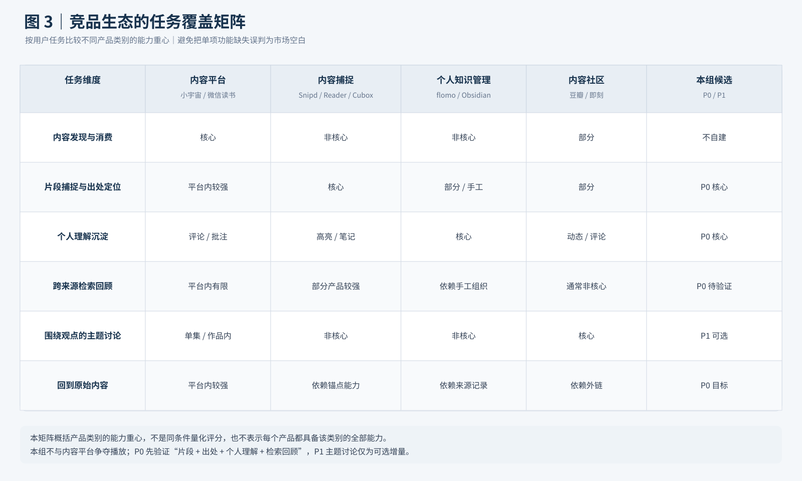
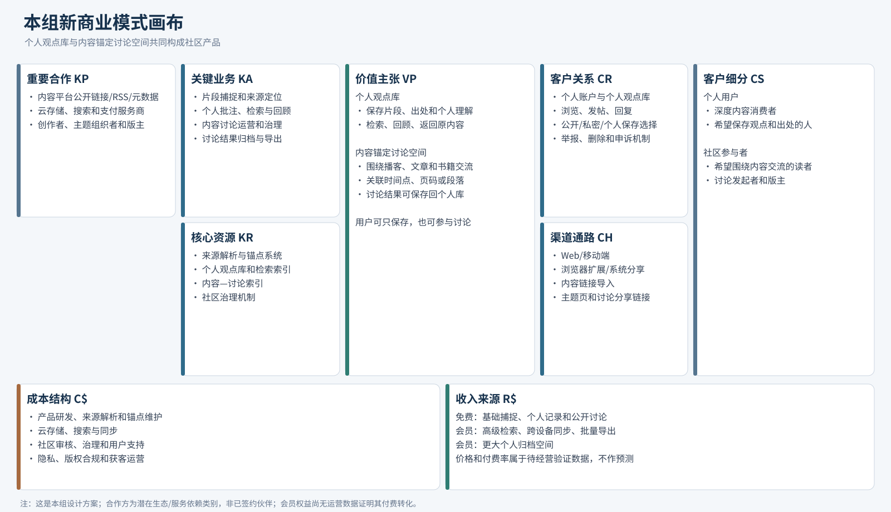

# 深度内容思考与共鸣社区：竞品选择与商业模式评估报告

> 课程作业终稿｜M1整合版
>
> 日期：2026-11-16｜负责人：M1
>
> 焦点竞品：小宇宙
>
> 研究范围：深度内容消费后的片段捕捉、出处保留、个人理解、检索回顾与内容锚定讨论。

## 摘要

播客、书籍和长文章中的一个具体片段，可能触发用户的共鸣、疑问或新的理解。用户随后可能想保存片段、保留出处、记下自己的想法，过一段时间再找回来；也可能希望把观点带给朋友，或围绕同一内容与其他读者交流。这些行为目前分散在内容平台收藏和评论、截图、个人笔记以及即时通信工具中。收藏、批注和评论功能已经十分常见，值得关注的是它们在不同工具之间衔接时产生的成本。

团队完成了 8 份真实访谈、16 份 AI 模拟访谈、十款代表产品的竞品研究，以及小宇宙商业模式和外部环境分析。真实访谈呈现了保存、分享、回找和讨论行为，也包含现有工具足够、不愿额外安装应用以及不愿公开表达等反向证据。AI 模拟仅用于探索反例，不计入真实样本。竞品研究表明，片段捕捉、出处定位、个人笔记和作品讨论均已有产品覆盖，单项功能层面已不存在明显空白。

本报告选择小宇宙作为课程焦点竞品，因为它连接播客发现、收听、时间点评论、原声回听、主播互动和创作者运营，能够展示深度内容消费场景中的多边商业模式。报告完成其九模块商业模式画布、四部分总体评估、价值主张 SWOT、商业模式环境 18 项分析，以及价值主张方向的 ERRC 和新商业模式画布。

本组最终提出的产品由两个相互连接的空间构成：**个人观点库**保存跨来源内容片段、出处和个人理解，支持检索、回顾与返回原内容；**内容锚定讨论空间**围绕播客单集、文章或书籍组织交流，让讨论关联具体片段、时间点或页码，并能将有价值的讨论保存回个人观点库。产品重点是把个人沉淀与内容交流连接成连续流程。社区空间属于产品结构的一部分，用户可以只记录、不公开，也可以浏览、回复或发起讨论。

---

## 一、选题与用户证据：内容消费之后的任务

### 1.1 问题界定

用户在收听播客、阅读书籍或浏览长文章时，可能遇到值得记住的片段。后续任务通常包括三个环节：第一，捕捉真正触发思考的片段，并记录其在原内容中的具体位置；第二，保留足以回到原内容的上下文，例如链接、播客时间点或书籍页码；第三，将自己的解释、疑问和联想与原始内容区分开来，以便之后检索和回顾。

交流是另一种后续任务。用户可能在原平台评论，也可能通过微信、QQ、朋友圈或线下交流；有些用户希望围绕同一作品或观点与更多人讨论。个人记录和公开讨论有不同的使用场景，却可以围绕同一个内容片段建立联系。

现有产品分别承担这些任务：小宇宙提供播客收听和时间点评论；微信读书连接原句划线、笔记和书友想法；Snipd、Readwise Reader、Cubox提供内容捕捉和来源定位；flomo、Obsidian支持个人记录与知识组织；微信、豆瓣和即刻承接分享或交流。用户可以组合这些工具完成任务，但需要自己复制内容、补充来源、切换应用或重新整理。

因此，本组聚焦的问题是：**当内容消费、个人记录和交流分散在不同工具中时，用户能否以较低成本保留片段及出处、表达自己的理解并在之后找回？个人观点又能否带着原始上下文进入讨论？**

### 1.2 真实访谈：行为线索与反向证据

团队完成 8 份真实访谈，采用便利抽样。访谈用于理解具体行为、动机和替代方案，不支持推断总体需求比例。另有 16 份 AI 模拟访谈，只用于探索反对意见和补充情境，不作为真实用户样本。[26,30]

| 访谈 | 受访者描述的行为 | 对产品研究的启示 |
|---|---|---|
| U01 | 关注 AI 和软件工程观点，浏览社交媒体并与朋友交流，更希望看到高质量观点，主动表达较少 | 观点发现和质量筛选可能有价值，但其个人记录需求不明确 |
| U02 | 阅读专业书籍，用平板笔记或 WPS 整理 PID、PLC 等概念关系 | 有知识整理行为；现有工具方便够用，是独立工具需求的反例 |
| U03 | 将趣味文案转发给朋友，后来翻聊天记录找过；手机笔记不便同时保留触发想法的背景 | 分享与个人想法可能分散；这类趣味文案体现即时分享需求，不能直接作为深度知识管理需求的证据 |
| U04 | 看到人物事迹短视频后进一步了解，并通过抖音分享给朋友 | 存在延伸了解和分享行为；没有明确的出处回找失败记录 |
| U05 | 听民俗播客后收藏整集、发朋友圈并与室友讨论；打开备忘录记录灵感时可能失去当下想法 | 即时捕捉可能有价值；但其认为收藏回找方便，也不愿在新工具中讨论 |
| U06 | 阅读观点后记入备忘录，并在课堂讨论中使用 | 个人记录可以进入线下交流；但偶尔记录不值得额外安装 App |
| U07 | 阅读小说片段后在评论区留言、截图并通过微信分享；使用书签和记事本保存 | 即时表达和分享真实存在；讨论动机可能短暂，现有截图和书签仍然省事 |
| U08 | 看到公众号观点后没有记录，只留在记忆中；另有分享视频并在线下讨论的经历 | 共鸣未必引发记录；出处需求和工具缺口因任务而异 |

这些案例呈现出明显的需求差异：U02 已有稳定笔记体系；U01 更重视观点发现；U05、U06 有保存或讨论经历，但对新工具的讨论功能兴趣有限；U07 的讨论动机具有即时性；U08 对出处的重视程度较低。样本支持对不同任务和行为的定性理解，独立工具需求与陌生人社区参与意愿仍需进一步验证。[26,30]

反向证据同样重要。受访者可能认为现有收藏和聊天记录足够，可能只在情绪高峰时想讨论，也可能只愿意把观点留给自己。新产品必须比截图、收藏、备忘录和熟人聊天更省力；功能更丰富本身不足以构成迁移动机。

### 1.3 产品范围：个人观点库与内容锚定讨论空间

本组将产品定位为深度内容的观点沉淀与交流社区，核心由两个相互连接的部分构成：

1. **个人观点库：**保存内容片段、出处和用户自己的理解，支持搜索、回顾、导出和返回原内容。
2. **内容锚定讨论空间：**围绕同一档播客、同一篇文章或同一本书形成讨论区；讨论可以关联具体时间点、页码或段落，用户可浏览、回复、发起主题讨论，并把讨论结果保存回个人观点库。

将讨论空间纳入产品结构，是本组根据课程选题和整体产品形态作出的设计决策。访谈呈现了分享、评论和交流行为，也记录了不愿额外安装工具或参与新讨论的反向意见，尚不足以证明所有用户都需要新社区。因此，产品同时提供个人观点库和内容锚定讨论空间：个人观点库可以独立使用，有交流意愿的用户则可围绕具体内容互动；个人记录始终由用户决定是否公开。产品不采用以关注、粉丝数、私信和泛娱乐信息流为中心的社交模式，大规模推荐和复杂关系网络也不属于当前方案范围。[26,30,34]

---

## 二、竞品选择与竞品生态

### 2.1 选择小宇宙作为焦点竞品

课程要求从拟创造的价值出发，选择最贴合的已有软件产品，并绘制完整商业模式画布。小宇宙连接播客发现、收听、时间点评论、原声回听、主播互动和创作者运营工具，是与本组方案最贴近的现有场景之一。

小宇宙最贴近播客内容消费与内容内互动场景，也适合作为课程要求的完整 BMC 分析对象。竞争关系分布在多个任务环节：内容平台承接消费与作品内互动，捕捉工具承接片段保存，知识管理工具承接长期整理，兴趣社区承接主题交流。小宇宙已经具备时间点评论和原声回听，微信读书也能把原句、笔记和书友想法连接起来。单独增加收藏、批注或评论难以形成差异化，因为这些能力已由现有产品覆盖。

### 2.2 竞品生态与任务覆盖

本组围绕“内容消费—片段捕捉—个人理解—检索回顾—主题交流”选择十款代表产品。

| 产品类别 | 代表产品 | 主要任务 | 对本组的参照 |
|---|---|---|---|
| 内容消费平台 | 小宇宙、微信读书、喜马拉雅 | 发现和消费播客/书籍，围绕节目或原句评论、笔记和回应 | 内容场景与平台内互动 |
| 内容捕捉工具 | Snipd、Readwise Reader、Cubox | 保存片段、标注、保留来源定位、汇集和回顾 | 捕捉成本与出处能力 |
| 个人知识管理 | flomo、Obsidian | 记录想法、标签组织、搜索、链接和长期沉淀 | 个人观点库的替代方案 |
| 内容与兴趣社区 | 豆瓣、即刻 | 围绕作品、兴趣小组或话题发布和交流 | 主题讨论的替代方案 |

**图 1｜竞品生态的任务覆盖矩阵**

这十款产品分属用户任务链的不同环节：内容平台覆盖内容消费与站内互动，捕捉工具提升记录效率并保留来源，知识管理工具支持长期沉淀与检索，内容社区承接主题交流和同好连接。用户可以同时使用其中几类产品，因此比较对象既包括单个 App，也包括“平台收藏 + 截图 + 个人笔记 + 微信聊天”这样的现有工具组合。产品能力重叠并不妨碍用户组合使用不同工具。[27,28]

### 2.3 竞品能力比较

**内容捕捉与出处定位已经有成熟方案。**小宇宙时间点评论可以回到音频时刻；微信读书可以对原句划线并写笔记，之后从笔记回到对应段落。Snipd支持带时间戳的播客片段和 Deep Link；Readwise Reader 的受测路径支持中文播客转录和段落级时间戳，但回放发生在 Reader 内；Cubox可以保存网页快照并定位句子，但本次受测跳回微信原网页时回到了页面顶部。[19-21,27,28]

需要区分不同媒介的定位能力：时间戳、段落定位和网页快照对应不同内容形态；高亮功能本身也无法保证出处上下文完整。内容捕捉已有成熟方案，本组需要验证的是跨来源记录能否与个人理解和讨论连续衔接。

**个人知识整理已有成熟产品覆盖。**flomo强调快速记录、标签、搜索和回顾；Obsidian以本地 Markdown 笔记和内部链接组织知识，其官方定价页将核心应用与 Sync、Publish 等付费服务区分；Readwise Reader连接阅读、标注和回顾。Cubox也提供网页剪藏、标注、搜索和导出能力。已有成熟记录习惯的用户需要看到明显的工作流收益，才有迁移动机。U02的访谈说明，现有笔记工具可能已经足够。[21-23,26-28,30]

**讨论能力已经存在，但组织单位各有不同。**小宇宙围绕播客单集和音频时点；微信读书围绕书籍原句；豆瓣围绕作品和小组；即刻围绕动态与话题；微信群聊和线下交流适合熟人沟通。评论和讨论社区已广泛存在。[24,25,28,29]

**本组的差异化应落在跨来源衔接。**本次研究中的产品分别在内容消费、片段捕捉、个人知识管理和主题交流上形成了成熟能力；本组希望把“跨来源片段及出处—个人理解—检索回顾—内容锚定讨论—讨论回流个人库”组织成一条连续工作流。这一机会来自竞品比较，实际价值仍需通过用户行为验证。

---

## 三、小宇宙完整商业模式画布

**图 2｜小宇宙商业模式画布（九模块）**

小宇宙连接听众、主播和节目制作团队、品牌方以及内容供给和支付渠道。创作者提供节目，平台组织发现、分发、播放和互动；听众贡献收听、订阅、评论和反馈，部分用户购买会员或付费内容；品牌方通过节目和创作者触达受众。以下画布依据公开资料、产品体验和成员研究整理，用于分析小宇宙的商业模式。[29]

### 3.1 客户细分（Customer Segments）

第一类是听众，包括免费收听、订阅和评论用户，以及购买 PLUS 工具权益或付费内容的用户。听众的参与深度不同：有人只收听，有人阅读评论，也有人主动发表评论或使用时点记录。行业调查显示，阅读评论与主动写评论是不同参与行为，因此听众细分应区分评论阅读者和主动表达者。[7]

第二类是主播、节目制作团队和运营者。他们是内容供给方，也是平台创作者工具和商业化服务的使用者。M3在一个创作者账号的后台体验到RSS认领、原生上传、节目管理和数据查看等入口。本项记录反映受测账号可见的功能，权限配置仍可能因账号而异。

第三类是品牌方或广告主。他们有播客投放、品牌内容或创作者合作需求，希望通过节目和主播触达特定受众。品牌方与普通听众的付费动机不同，会员收入和品牌合作收入应分别分析。

### 3.2 价值主张（Value Propositions）

对听众，小宇宙提供播客发现、收听和追更体验，并通过时间点评论、回复和时间戳回听，让用户围绕具体声音时刻交流。PLUS公开权益包括时点收藏、私人笔记、AI播客总结、会员周报和个性图标等；2026年11月11日安卓会员页记录还列出外语播客同传和付费内容优惠。[15,16,29]

对创作者，官方主播指南介绍了回复、置顶、公告、投票等互动工具；M3在一个创作者账号后台体验到RSS认领、原生上传、评论管理和数据看板等入口。对品牌方，COO访谈及品牌合作材料展示了品牌内容和追光商单的合作形态。这些材料能够确认相关功能和合作入口，尚不足以判断其对留存、付费转化或广告效果的实际影响。[17,18,29]

### 3.3 渠道通路（Channels）

听众通过应用商店、站外分享、发现页、搜索、节目页、订阅页和播放器触达内容。发现和搜索帮助选集，节目页辅助判断，订阅页帮助追更，播放器负责交付和续播。M3在一个创作者账号后台体验到网页后台、RSS认领和原生上传等入口；品牌方可通过品牌资源和商单合作入口寻找节目与创作者。[17,18,29]

### 3.4 客户关系（Customer Relationships）

听众侧以自助发现、订阅更新和续播维持日常关系；时间点评论、楼中楼回复、高能点赞和主播互动形成平台内关系；PLUS提供会员服务。官方主播指南介绍了评论回复、投票、公告等工具，M3单账号后台体验还记录了评论管理等入口；品牌合作更接近项目制对接。M2的单次体验验证了短时回访路径，长期留存和忠诚度仍缺少数据支持。[17,29,30]

### 3.5 收入来源（Revenue Streams）

可确认的商业化入口包括PLUS连续会员、付费内容、听众赞赏，以及品牌播客和追光商单合作。其中，PLUS为公开会员产品；付费内容和赞赏入口来自M3对一个创作者账号后台的单次实测；品牌合作形态由COO访谈和公开合作案例支持。M2于2026年11月11日在安卓端记录到连续包月15元、连续包年120元；App Store页面也记录了15元/月、120元/年的展示价格。[15-18,29]

上述价格为页面展示价。由于创作者分成、付费内容资格与结算基数、渠道订单占比、品牌服务费和收入结构缺少可核验的公开数据，本报告不估算平台净收入，也不采用单账号后台展示的分成比例。

### 3.6 核心资源（Key Resources）

核心资源包括节目供给、播放器和发现/搜索系统、听众互动网络、创作者关系、主播后台和数据看板，以及播客大赏、线下活动和品牌资源所积累的品牌资产。M3单次后台体验记录了订阅、播放、收听时长、听众画像、完播率、留存曲线和互动表现等数据类型；该记录用于确认后台可见的数据类型，尚不能据此判断平台是否对外销售数据产品。[29]

### 3.7 关键业务（Key Activities）

平台需要开展内容发现、推荐、节目分发与播放、时间点互动和社区运营、创作者服务、会员与付费内容运营、赞赏和品牌商单支持，以及内容治理和举报处理。小宇宙的业务覆盖音频播放之外的多个环节：评论区维护、创作者工具、品牌商务对接和用户生成内容治理。

### 3.8 重要合作（Key Partnerships）

生态参与者和外部依赖包括主播、节目制作机构和 RSS 内容供给方；品牌广告主及合作机构；应用商店、支付服务；播客大赏、线下活动和行业合作方。Apple是iOS端App Store分发和内购渠道之一。安卓端可见会员购买入口，本轮尚未核实具体支付方式、适用费率和订单占比，因此暂不对全平台渠道结构作判断。云存储、CDN等属于可能的基础设施依赖，具体供应商和合同未公开；监管机构则属于外部制度约束，均不纳入已确认的商业合作伙伴。[17,18,29]

### 3.9 成本结构（Cost Structure）

小宇宙的成本主要由内容分发、技术研发、社区治理和商业运营共同驱动。原生托管需要存储音频文件，播放和分发需要带宽及相关服务；RSS接入则让平台能够连接外部节目，减少对所有音频进行自有托管的依赖。两种方式并存，使平台在节目供给开放度与服务控制力之间取得平衡。平台仍需承担内容授权、音频处理和基础设施成本。

此外，播放器、搜索推荐和主播后台需要持续研发维护；评论、上传内容和付费节目需要治理与合规投入；会员、付费内容和品牌合作还会带来支付渠道、创作者结算、商务沟通和项目执行成本。随着节目供给、收听规模和互动活动增长，基础设施与治理投入也会增加。各项成本的具体金额和占比没有公开，因此本报告分析成本驱动关系，不估算实际利润。[29]

渠道费用也会影响平台最终留存的交易收入。中国大陆区 Apple 开发者协议自2026年3月15日起规定标准佣金为25%，符合规定条件时为12%；小宇宙实际适用档位和各渠道订单结构未知，因此不计算净收入。[29,41]

### 3.10 九个模块之间的价值流动

小宇宙的价值流可以概括为“创作者供给内容—平台组织发现与分发—听众消费并反馈—创作者持续经营—品牌方购买传播服务”。听众的收听、评论、点赞和分享既构成平台互动，也为创作者理解受众提供反馈；会员、付费节目和赞赏让部分听众直接付费，品牌合作则把节目和创作者资源转化为企业传播服务。平台通过技术、创作者工具、内容治理和商务协调维持这套生态，并从不同交易关系中获得收入机会。

这套模式包含多边价值交换：创作者供给决定内容丰富度，听众规模和互动质量影响创作者与品牌方的参与价值，治理能力则影响社区体验能否持续。收入来自不同付款方，成本也分布在内容分发、创作者服务、渠道和治理等环节。

---

## 四、总体评估与 SWOT

本组选择**价值主张**作为深入 SWOT 的部分。S/W属于小宇宙内部特征，放在价值主张画布项内；O/T属于外部机会和威胁，放在画布项旁并用箭头指向价值主张。用户界面、基础设施、收入与支出只完成加分项和减分项标注，符合课程要求。[31]

**图 3｜总体评估与价值主张 SWOT**

### 4.1 价值主张 SWOT

| 类型 | 判断 | 依据 |
|---|---|---|
| S1 优势 | 评论与原声时刻绑定 | M2在安卓端点击评论时间戳回到相应音频，页面仍停留在评论区；一小时后找回自己的记录。[29] |
| S2 优势 | 主播可以围绕单集组织互动 | 官方指南说明主播可回复、置顶和发起投票；后台体验也记录了相关入口。[17,29] |
| S3 优势 | 发现、订阅和播放链路较完整 | M2单次旅程走通搜索、订阅、暂停续播和评论回听；仅代表受测版本和路径。[29] |
| W1 劣势/边界 | 价值主张主要围绕播客消费场景展开 | 小宇宙的核心互动与时间点评论紧密结合节目和单集；跨媒介内容的统一沉淀尚未构成其主要价值主张。[29,30] |
| W2 劣势/边界 | 免费层的私密时点记录能力有限 | 官方 PLUS 发布说明将时点收藏及私人笔记列为会员权益；M2在非会员受测路径中未找到同粒度的私密记录入口。[16,29] |
| O1 机会 | 阅读评论的听众多于主动写评论者 | 2024年中文播客调查中54.6%受访者会看评论、19.4%会写评论；两种行为可重叠，非小宇宙独立样本。[7] |
| O2 机会 | 部分用户已有分享和讨论行为 | U03—U08等真实访谈出现不同形式的分享、讨论或回应；便利样本提供了行为线索，尚不足以判断新社区的迁移意愿。[26,30] |
| T1 威胁 | 用户注意力和收听时间有限 | 2024年调查中，过半受访者订阅超过十档节目，但每周定期收听十档及以上者不足5%。[7] |
| T2 威胁 | 内容平台、笔记工具、社区和熟人聊天均可替代部分任务 | 小宇宙、微信读书、喜马拉雅、捕捉工具、豆瓣、即刻和微信群聊分别承接消费、保存或交流任务。[27,28] |

SWOT显示，小宇宙的优势在于播客场景内的内容消费、原声互动和创作者运营；其价值边界也与播客这一媒介和节目组织方式紧密相关。外部机会来自用户在不同平台、笔记工具和熟人沟通之间的切换，跨来源衔接仍有改进空间。与此同时，成熟工具和低成本替代方式提高了新产品的迁移门槛。因此，本组应聚焦个人沉淀与内容锚定讨论的连接，避免重复建设评论区。

### 4.2 用户界面（CS / CH / CR）

**加分项：**免费听众可以完成基础收听、订阅和评论；PLUS为持续整理需求者提供增值工具；主播和品牌方有相应服务入口。搜索能够把明确兴趣带到单集，订阅页和播放器分别承接追更与续播，时间点评论可回到原声。主播可通过投票、回复和置顶组织互动。[18,29,30]

**减分项：**M2单次首访未从发现页直接找到感兴趣内容而转向搜索；非会员私密记录入口在受测路径中未找到；站外分享回到原讨论的路径没有完整记录。这些观察仅覆盖受测账号和路径，尚不足以判断平台整体能力。长期留存、获客成本和品牌忠诚度也缺少可比数据。

### 4.3 基础设施（KR / KA / KP）

**加分项：**RSS与原生托管提供多路径节目供给；时间点评论、回复和主播互动形成平台内互动网络；主播后台和数据看板支持节目运营；播客大赏、线下活动和品牌资源帮助维持创作者及品牌关系。[17,29]

**减分项：**创作者可多平台分发，平台对独家供给的控制有限；RSS与原生托管并存，使平台能够以较开放的方式组织节目供给，并减少对所有音频自有托管的依赖；但播放分发、内容处理和权利管理仍需投入。后台数据支持创作者运营，评论、上传内容和付费节目也带来持续治理需求。[29]

### 4.4 收入与支出（R$ / C$）

**加分项：**小宇宙形成了“听众订阅 + 内容交易 + 品牌合作”的多元收入组合。PLUS提供持续性订阅基础，付费内容和赞赏把听众支持转化为创作者收益，追光商单则将节目和创作者资源延伸到企业客户市场。[15-18,29]

**减分项：**会员续费、付费内容供给和品牌项目都需要持续经营：会员权益必须持续创造价值，付费内容需要足够丰富的创作者供给，品牌合作则受营销预算和项目周期影响。与此同时，音频分发、研发、社区治理、渠道佣金和创作者结算会持续消耗资源。平台未公开完整财务数据，因此本报告只分析收入与成本的形成逻辑，不评价各收入线的实际利润或平台整体盈亏。

### 4.5 四部分综合判断

四部分评估应关注模块之间的支撑关系，重点在于：价值主张吸引听众和创作者，渠道与客户关系决定内容能否被发现、消费和讨论，核心资源与关键业务维持内容供给和互动质量，收入机制则需要覆盖技术、渠道和运营投入。小宇宇宙在播客场景内形成了较完整的服务组合，公开财务数据仍不足以判断其实际盈利表现。对本组而言，产品方案还需考虑来源锚点、社区治理、个人数据管理以及相应成本。接下来，外部环境分析将进一步检视这些能力受到哪些市场、行业、技术和宏观因素影响。

| 部分 | 加分项 | 减分项 | 结论 |
|---|---|---|---|
| 价值主张 | 时间点互动、原声回听、主播互动 | 主要围绕播客内容组织，私人时点记录属于会员权益 | 场景价值明确，跨来源主题组织是本组可研究的差异方向 |
| 用户界面 | 搜索、订阅、续播、评论回听 | 首访发现路径存在摩擦；站外回流路径记录不完整 | 基础链路完整，个别入口体验有改进空间 |
| 基础设施 | 社区互动、创作者工具、数据看板、开放供给 | 创作者多平台分发、供给独家性有限 | 资源开放但不具强独家性 |
| 收入与支出 | 多元商业化机制 | 财务披露不足，无法评价收入结构和盈利能力 | 商业化机制存在，财务表现不作推断 |

---

## 五、商业模式外部环境：18 项分析

本章按照课程课件核对的 18 个子方向，分析市场、行业、技术、社会和宏观条件如何影响小宇宙的客户、价值主张、合作、收入与成本，并据此识别本组方案面临的机会和约束。分析以小宇宙为焦点竞品；涉及本组产品的内容均作为设计启示，并明确其尚未运营。18 个子方向名称依据团队对课件第 16 页的核对记录，具体分析问题由团队结合研究对象展开。[31,40]

### 5.1 市场影响力（5 项）

#### 5.1.1 市场分类

将这三类参与者统称为“用户”会掩盖价值主张和收入来源之间的差异。对小宇宙而言，听众规模、会员规模、评论活跃度和品牌合作收入分别反映不同经营环节。

2024年中文播客调查中，54.6%的受访听众表示收听单集时会看评论，19.4%会写评论；两类行为可以重叠。[7]小宇宙的听众既包括主动表达者，也包括通过阅读评论理解节目、判断是否收听的旁听者。客户细分可按发现、追更、看讨论和主动表达等任务理解；主播、品牌方则属于不同客户侧参与者。该调查样本并非小宇宙用户抽样，只能作为行业参与行为的参考，不能用于估算平台客户占比。

#### 5.1.2 需求和诉求

用户需求还受到表达场景和隐私预期影响。同一条观点，用户可能只想私下保存，也可能愿意发给熟人，或希望进入公开讨论。公开评论有机会获得更多回应，但会增加表达压力；私人记录更适合尚未形成完整观点的想法，却不一定产生社区互动。小宇宙将时间点评论和私人时点笔记放在不同使用场景中，说明公开交流和个人沉淀本来就是两种不同关系。对本组而言，个人库与讨论空间应当连接，同时保留清晰的隐私边界，让用户自主决定是否公开私人观点。

第一章的访谈案例显示，用户会在私人记录、熟人分享和公开评论之间切换，公开讨论只适用于部分用户。[26,30]小宇宙将时间点评论与 PLUS 私人时点笔记放在不同使用场景中，说明个人沉淀和公开交流可以相互连接，但需要保留各自的使用边界。对本组而言，机会在于让用户自主选择观点的保存范围和交流方式，降低从个人记录进入讨论的摩擦。

#### 5.1.3 市场问题

订阅清单和实际收听之间存在差距。单集需要在用户更新列表和有限时间中争取注意力，平台推荐、节目标题、单集简介和听众分享共同影响实际触达。品牌方更关注节目触达目标人群的能力，订阅数字只是参考指标之一。因此，订阅数、播放量、完播率和评论量应分别观察。

2024年调查中，过半受访者订阅超过十档节目，但每周定期收听十档及以上者不足5%。[7]订阅数与实际收听量存在差距，平台仍需争取用户有限的注意力。M2单次首访未从发现页直接找到感兴趣的单集，转而搜索关键词后选中节目。[29]这一体验说明搜索和主题匹配对该用户当时的发现过程很重要，尚不足以评价推荐系统整体效果。

#### 5.1.4 切换成本

切换成本来自内容本身，也来自用户已经积累的订阅、评论、播放进度和个人记录。播客可以通过 RSS 在不同平台收听，因此单纯更换播放器的成本相对有限；但评论和时间点收藏可能留在原平台，个人笔记又分散在其他工具中。M2在小宇宙从“我的评论”找回时间点、在微信读书从笔记回到高亮原句，U05则把收藏、记录和熟人讨论分散在不同入口。[26,29,30]这些案例表明，用户可能多平台并用。小宇宙需要持续提供播放与互动价值；本组方案则应允许与原平台共存，减少用户迁移旧内容的负担。

#### 5.1.5 收入吸引力

收入吸引力还要区分付款主体和价值单位。会员按时间购买持续工具权益，付费节目按内容购买，赞赏表达对创作者的支持，品牌合作则购买传播服务。四种交易的决策者、付费频率和成本结构并不相同。现有证据能够确认这些机制存在，尚不足以比较各收入线的贡献。对本组的新商业模式，个人会员对应长期检索、同步和归档价值；公开讨论则承担社区活跃和内容供给功能。二者能否形成付费关系，需要通过实际使用和购买行为检验，竞品已有会员体系不足以证明本组用户也愿意为相关服务付费。

小宇宙公开提供PLUS、付费内容和品牌合作入口；M2于2026年11月11日记录到PLUS连续包月15元、连续包年120元。益普索2025年播客调查（活跃播客用户N=2,237，其中受访者均有播客广告收听经历）中，38%的受访者称2024年购买付费节目或专辑的金额较2023年增加，42%称因播客广告或主播推荐产生的消费金额增加。该调查于2025年4月30日至5月22日在线执行，结果属于受访者自报，不宜外推至全体播客听众或小宇宙用户。[8,16,18,29]这些行业数据提供付费市场背景，不能代表小宇宙实际收入，也无法证明用户愿意为观点管理工具付费。

### 5.2 行业影响力（5 项）

#### 5.2.1 供应商和价值链上的其他厂商

小宇宙的价值链由主播和节目制作机构、RSS 与原生托管、音频存储与分发、应用商店与支付渠道，以及品牌广告主和制作机构共同构成。创作者多平台分发有利于节目供给扩充，却降低平台对独家内容的控制；托管与分发服务影响播放质量，应用商店和支付渠道影响触达与交易，品牌代理和制作机构则可能参与商业项目交付。[17,18,29]对本组而言，不自建播放器可以减少对音频托管的依赖，但来源解析、锚点跳转、搜索和数据存储仍是必要的技术服务。

#### 5.2.2 利益相关者

小宇宙需要协调听众、创作者、品牌方、应用商店和监管部门等利益相关者。听众希望内容和讨论质量高、广告干扰少；创作者希望获得播放、反馈和收益；品牌方关注受众匹配与投放效果；平台需要收入覆盖技术和运营投入；监管部门则规定内容和数据处理边界。[17,18,29,32]各方目标存在张力。对本组而言，讨论空间除了发帖者，还要考虑浏览者、被讨论内容的权利人和被举报用户；版主与创作者可以作为潜在社区治理参与者，合作关系仍需实际建立。

#### 5.2.3 现有竞争对手

小宇宙的竞争者还包括其他类型的平台。喜马拉雅和网易云音乐在综合音频内容、收听和会员消费上竞争；Apple Podcasts依托系统入口和全球节目目录触达听众；B站则以视频内容、创作者扶持和既有流量争夺播客创作者与用户注意力。[12-14,32,39]这些平台分别在内容库、社区流量、系统入口和视频化制作方面具有优势。小宇宙的差异集中在垂直播客体验、时间点互动和社区氛围；对本组而言，这些内容平台既是用户的内容来源，也是个人沉淀和讨论产品需要共存的外部场景。

#### 5.2.4 新进入者（挑战者）

新进入者不仅带来相似功能，也会改变创作者的收益预期和内容制作方式。B站持续推进视频播客，2025年7月公布的“视频播客出圈计划”包括流量扶持、AI 创作工具和多城录制场地；小红书、抖音等平台也开始布局视频播客。[14,32,37]这些平台凭借既有流量和制作资源改变播客内容的生产、分发与变现方式。与此同时，Readwise Reader 等工具将转录、摘要和片段管理从内容平台中抽离出来。[19,20,27]小宇宙仍可发挥纯音频、垂直社区和时间点互动的价值，但需要面对创作者和听众在多平台之间分工使用的趋势。

#### 5.2.5 替代产品和服务

替代关系同时发生在内容消费、个人记录和交流环节。短视频、网络音乐和长视频争夺用户有限的注意力；微信转发和线下聊天适合低成本熟人交流；豆瓣小组和即刻话题提供现成的作品或兴趣讨论网络；备忘录、flomo和 Obsidian 则能完成个人记录。[35,36]CNNIC第56次报告显示，截至2025年6月，短视频网民使用率为95.1%、网络音乐为64.5%；长视频用户规模占网民整体62.4%的数据来自中国网络视听节目服务协会对该报告的发布解读，三项来源口径已分别标注。这些数据反映用户拥有丰富的内容替代选择，无法直接说明播客用户的迁移比例。新产品应与原平台共存，并明确内容锚定讨论相较于熟人聊天和现有社区的增量价值。

### 5.3 关键趋势（4 项）

#### 5.3.1 技术趋势

转录、摘要和片段检索已可由第三方工具提供，平台可优先接入成熟能力；跨来源锚点仍需处理不同链接格式、播客时间戳和书籍页码，搜索需要索引个人记录与公开讨论，跨设备使用则涉及存储和隐私保护。小宇宙 PLUS 页面出现 AI 播客总结权益，Readwise Reader 受测路径支持中文播客转录和段落时间戳，视频播客也在扩展内容形态。[16,19,20,27]这些技术能够改善理解、检索和回顾，也带来摘要准确性、来源标注、版权和推理成本问题。首版技术选择应围绕片段、出处、个人理解和讨论等核心任务。

#### 5.3.2 行业管理趋势（监管）

内容锚定讨论需要同时处理版权、隐私和社区治理。来源链接、定位信息和用户原创评论通常比长期托管完整音频或文章涉及更少的内容复制；短片段和链接仍需结合具体使用方式判断授权及平台责任。讨论区还要处理侵权投诉、隐私信息、骚扰和垃圾内容；若加入算法推荐或生成式 AI，则需结合实际服务形态判断相应义务。《人工智能生成合成内容标识办法》自2025年9月1日起施行，《互联网信息服务算法推荐管理规定》对适用的推荐服务提出审核、数据安全和个人信息保护要求，著作权法则规定作品及相关制品的传播权利。[9-11]因此，来源元数据、时间点/页码、用户原创表达、举报和申诉机制都应在产品设计阶段纳入。

#### 5.3.3 社会和文化趋势

深度内容消费中的参与程度存在差异：有人完整收听，有人阅读评论，也有人愿意写评论或参与多轮对话。复旦大学信息与传播研究中心与小宇宙联合发布的中文播客公共价值报告，结合平台节目及用户数据、主播问卷、访谈和案例开展分析；平台数据部分显示，18—35岁听众占比超过83%，日均收听时长约79分钟，23.7%的单集评论区出现多轮对话，月收听超过100小时的重度用户中评论意愿为49.2%。报告另有主播问卷，回收1655份、有效1540份，该样本量不适用于上述平台听众行为指标。[6]这些数据说明播客场景中存在愿意深入交流的群体，也提示社区需要容纳浏览者、轻度参与者和主动表达者；其迁移到新社区的意愿仍需验证。

#### 5.3.4 社会经济趋势

付费能力和付费对象也需要区分：用户可能愿意为内容本身付费，却不愿为额外工具付费；也可能长期使用免费笔记工具，只为同步、搜索或存储升级。国家统计局数据显示，2025年居民人均可支配收入为43,377元、同比名义增长5.0%，人均教育文化娱乐消费支出为3,489元、增长9.4%；文化及相关产业营业收入增长8.8%，文化服务业增长12.8%。居民收支来自全国16万户抽样调查，文化产业数据则覆盖相关企业及事业单位等不同统计对象。[1,3]中国网络视听节目服务协会发布的《2026年网络音频发展报告》披露，2025年互联网音频年度付费用户约1.88亿、有声阅读市场营收约134亿元，统计范围涵盖广义互联网音频和有声阅读，不能直接用于估算播客付费用户或小宇宙收入。[42]益普索2025年播客调查中，38%的活跃受访听众称付费节目或专辑消费金额较上年增加，42%称因播客广告或主播推荐产生的消费金额增加；调查对象为有播客广告收听经历的活跃用户，数据为自报消费变化。[8]这些行业资料提供付费市场背景，尚不能估算本组工具的付费率。新方案应先让免费功能形成明确价值，再通过使用行为验证高级检索、同步和归档是否值得收费。

### 5.4 宏观经济影响（4 项）

#### 5.4.1 经济基础设施

移动网络、应用商店和支付体系降低了内容分享、跨设备使用和会员交易的基础门槛，但浏览器扩展、系统分享和多端同步仍需适配不同操作系统。产品应尽量沿用用户已有的分享、浏览和导出习惯，避免把安装新应用变成保存观点的第一道障碍。截至2025年12月，中国网民规模达11.25亿人，互联网普及率为80.1%；工信部统计年末5G移动电话用户为12.04亿户，占移动电话用户总数的65.9%。该指标以移动电话用户户数为统计口径，不能视为去重后的自然人数。[4,38]这些基础设施为多端内容服务提供条件，同时也带来应用商店、支付渠道和平台 API 依赖。

#### 5.4.2 大宗商品和其他资源

云计算、数据中心、存储和带宽构成数字内容服务的基础资源。2025年通信业云计算、大数据、移动物联网和数据中心等新兴业务收入合计4508亿元，同比增长4.7%；三家基础电信企业对外提供服务的数据中心机架数达93.8万个，移动互联网接入流量达3958亿GB，增长17.3%。[4]这些数据反映基础设施供给规模，无法据此估算小宇宙或本组产品的云服务单价。对小宇宙而言，音频托管、带宽和审核是主要成本驱动；本组方案不自建播放器，可避免自有音频托管和播放分发的主要投入，来源解析、锚点维护、搜索、存储和社区治理仍需投入。

#### 5.4.3 资本市场

宏观融资环境会影响企业获得资金和扩大投入的条件。2025年末中国社会融资规模存量按可比口径增长8.3%，全年社融增量35.6万亿元；IMF对中国的国别分析指出，政府债券发行是社融增长的重要推动因素，并讨论了私人部门信贷增长趋缓。[2,5]社会融资规模反映整体融资环境，无法直接衡量消费互联网项目获得股权融资的难易程度。这些数据不足以判断小宇宙的融资能力、估值或现金流。对本组方案而言，融资环境本身也无法替代商业模式验证；早期仍需验证用户是否重复保存、检索和参与讨论，以及会员收入能否覆盖存储、搜索、治理和获客成本。

#### 5.4.4 全球市场情况

全球增长、通胀和品牌预算变化可能通过广告支出、云服务采购和用户可支配支出间接影响数字内容平台。IMF在2026年10月《世界经济展望》表1.1（按购买力平价权重）中估计全球经济2025年增长3.5%，预计2026年增长3.1%、2027年增长3.4%；全球消费者价格涨幅预计2026年为4.7%。[33]这些指标为理解全球经营环境提供背景。小宇宙和本组产品主要面向中文内容消费场景，全球增速无法直接用于估算中国播客需求、平台收入或用户付费能力。

### 5.5 外部环境综合结论

18项外部环境分析形成四个与本组方案直接相关的判断。第一，用户注意力有限，内容平台之间竞争激烈，增加内容供给仍需配合推荐、主题匹配和用户分享，才能提升有效触达。第二，捕捉、笔记和讨论功能已由不同产品覆盖，产品机会在于降低跨工具衔接成本。第三，技术和基础设施让跨来源服务成为可能，来源锚点、版权、隐私和社区治理则构成持续约束。第四，内容消费存在付费市场，但行业付费规模尚不足以说明用户愿意为观点管理工具付费。由此，本组需要在保持个人记录低门槛的同时，把内容锚定讨论纳入产品结构，并通过自愿参与、清晰治理和个人增值服务控制运营复杂度。

---

## 六、蓝海战略：围绕价值主张重组个人沉淀与内容讨论

**图 4｜价值主张 ERRC 四项行动框架**

### 6.1 战略问题

前期研究揭示的核心问题在于功能分散造成的衔接成本：小宇宙把评论与播客原声连接起来，微信读书把笔记与原句连接起来，Snipd、Readwise Reader 和 Cubox提供捕捉与回顾，flomo 和 Obsidian 提供个人沉淀，豆瓣和即刻提供作品或话题讨论。用户可以分别完成这些任务，但在跨来源保存、个人理解、内容讨论和长期回顾之间仍需要自行搬运与整理。

因此，蓝海战略聚焦于重组价值关系：以片段和出处为共同上下文，把个人观点库与内容锚定讨论空间连接起来。用户可以先私下保存，再选择是否参与讨论；讨论中的有价值观点又能回到个人库。工作流的连通性构成产品差异化，个人笔记和评论区则是已有基础能力。

### 6.2 竞争要素与价值曲线

| 竞争要素 | 内容平台 | 捕捉工具 | 个人知识管理 | 内容社区 | 本组方案 |
|---|---|---|---|---|---|
| 内容发现与消费 | 平台内较强 | 非核心 | 非核心 | 部分产品具备 | 不自建播放器 |
| 片段捕捉与出处定位 | 平台内较强 | 核心能力 | 依赖导入或手工 | 多为作品级 | 核心能力 |
| 个人理解沉淀 | 评论/批注 | 高亮/笔记 | 核心能力 | 动态/评论 | 核心能力 |
| 跨来源检索回顾 | 平台内有限 | 部分产品较强 | 依赖组织或导入 | 非核心 | 核心能力 |
| 内容锚定讨论 | 单集/作品内 | 受测路径以个人捕捉为主 | 非核心 | 话题/作品级 | 核心能力 |
| 讨论回流个人库 | 平台内记录 | 导出/同步 | 可手工整理 | 依赖用户另行保存 | 产品内连通 |

该表依据成员产品研究形成定性比较，未采用用户量表评分或同条件量化测试。产品将播放留给成熟平台，并以片段、出处、个人理解和内容锚定讨论的衔接作为核心差异。[28,29,32]

### 6.3 ERRC 四项行动

**删除（Eliminate）。**删除自建播放器、音频托管和完整音频内容分发链路，避免与小宇宙、喜马拉雅争夺收听时长；删除以粉丝数、关注流和私信为中心的泛社交结构。产品仍然提供内容锚定的讨论与观点分享，但不把用户关系和泛娱乐信息流作为核心。

**消减（Reduce）。**减少强制长笔记、复杂标签和手工补齐全部出处的要求；减少泛娱乐信息流和复杂推荐；不自研音频转录与内容托管，不复制完整音频或文章。用户只需留下片段和一句理解，也可以先保存后整理。

**提升（Raise）。**提升来源锚点的可靠性，尽可能保留播客时间点、文章链接、书籍页码或段落；提升原始内容与个人理解的区分；提升讨论上下文质量，使用户知道讨论针对哪段内容；提升讨论结果回到个人观点库的能力。

**创造（Create）。**创造以节目、文章和书籍为单位的内容锚定讨论空间。每条讨论可以关联具体片段、时间点或页码；用户可以从个人观点库发起讨论，也可以从主题空间浏览、回复和保存观点。讨论结果能够回流个人库，形成“捕捉—理解—讨论—回顾”的闭环。该方向保留社区属性，但不建设泛社交广场。[26,30,34]

\newpage

### 6.4 新商业模式画布

**图 5｜本组新商业模式画布**

{latex-placement="H"}

**新商业模式画布的九个模块：**

- **客户细分：** 经常消费播客、书籍和长文章、愿意保存观点的个人用户；希望围绕作品或主题交流的读者、听众和讨论组织者。
- **价值主张：** 跨来源保存片段及出处、记录个人理解、检索回顾；围绕同一内容开展锚定讨论，并将讨论结果保存回个人库。
- **渠道通路：** Web/移动端、浏览器扩展或系统分享入口、内容链接导入、主题页和讨论分享链接。
- **客户关系：** 个人观点库归用户管理；讨论区允许浏览、发帖和回复；用户可选择公开、私密或仅个人保存。
- **收入来源：** 免费基础捕捉和公开讨论；个人会员提供高级检索、跨设备同步、批量导出和更大个人归档空间。
- **核心资源：** 来源解析与锚点系统、个人观点库、内容—讨论索引、检索系统和社区治理机制。
- **关键业务：** 片段捕捉、来源定位、个人批注、检索回顾、内容讨论运营、讨论治理和数据导出。
- **重要合作：** 内容平台公开链接/RSS/元数据生态；云存储、搜索和支付服务商；创作者、主题组织者和社区版主。
- **成本结构：** 产品研发、来源解析与锚点维护、云存储和搜索、社区审核与治理、用户支持、隐私和版权合规、获客运营。

该画布呈现本组提出的产品与商业模式，方案仍处于设计阶段。收入采用“免费基础功能 + 个人会员增值服务”：基础捕捉和内容讨论保持低门槛，付费点集中在高级检索、跨设备同步、批量导出和长期归档等持续的个人价值上。个人记录和回顾能够形成持续使用价值，免费讨论则有助于降低参与门槛并积累内容与互动。若首发即对发帖或回复收费，可能抑制社区参与。首版暂不引入付费内容分成和品牌广告，以控制内容权利、交易结算和商务交付的复杂度。以上是与产品定位相匹配的商业模式假设，会员付费意愿和社区参与仍需后续验证。

### 6.5 价值流与成本逻辑

用户从播客、文章或书籍带入片段，系统尽可能保留来源链接、时间点或页码；用户补充个人理解后，可以将观点留在个人库，也可以带入对应内容的讨论空间。其他用户围绕同一内容补充、质疑或回应，浏览者也可以通过阅读讨论获得价值；用户再将有价值的讨论保存回个人库。由此，个人沉淀与社区交流形成双向连接，减少用户在笔记工具和聊天工具之间手工搬运的步骤。

成本结构也随之调整：本组方案不自建播放器和完整音频内容库，可避免自有音频托管与播放分发的主要投入；相关成本将转向来源解析、锚点维护、搜索、个人数据存储和社区治理。版权方面优先保存来源链接、定位信息和用户原创表达，不默认复制完整内容；讨论区需要举报、删除、申诉和版主管理机制。若引入 AI 转录或摘要，还需处理调用成本、来源标注和人工校验。

### 6.6 可行性与主要风险

本方案能否落地，既取决于功能实现，也取决于用户是否愿意把已有习惯迁移到新的工作流。首先，社区冷启动需要围绕具体内容形成足够的初始供给和互动；开放讨论区本身不会自然产生交流，可从少量主题、课程小组或邀请制讨论开始，观察浏览、发帖、回复和回访是否发生。其次，跨平台锚点可能因链接失效、页面改版、内容下架或平台权限变化而失准，应保留来源链接、定位信息和必要的失效提示，并将无法稳定跳转作为产品边界。再次，公开讨论需要明确版权、隐私、举报、申诉和版主管理规则，片段保存也需要结合具体使用方式判断权利风险。最后，会员权益应通过真实使用验证：先观察用户是否持续保存、检索和回顾，再判断高级检索、同步和导出是否形成付费价值；AI能力应在核心工作流验证后再决定投入规模。

---

## 七、结论与研究边界

本次研究形成三项结论。

第一，用户已经拥有收藏、笔记和评论工具，但完成跨平台任务时仍需组合使用。真实访谈既呈现了保存、回找和讨论行为，也显示现有工具对部分用户已经足够；因此，研究支持的是具体工作流摩擦，独立工具需求和迁移意愿仍需验证。

第二，竞品生态中的单项能力已经相当成熟。小宇宙擅长播客消费和时间点互动，微信读书连接原句与书友想法，捕捉工具和知识管理工具分别覆盖保存、标注、检索和回顾，豆瓣与即刻承接作品和兴趣讨论。本组的设计机会在于把跨来源片段、出处、个人理解和内容锚定讨论连接起来，形成整合价值。

第三，本组最终选择“个人观点库 + 内容锚定讨论空间”的产品结构。个人观点库承接私密保存、检索和回顾，讨论空间为愿意交流的用户提供围绕具体内容的互动，并允许讨论成果回流个人库。社区是产品组成部分，但参与是自愿的；产品不自建播放器，也不建设泛社交信息流。商业模式以免费基础捕捉和讨论、个人会员增值服务为初步设计，成本则从音频托管转向来源解析、锚点维护、搜索存储和社区治理。

研究边界包括：①8份真实访谈为便利样本，只支持定性行为线索，不推断总体比例；16份AI模拟不计入真实用户证据。②竞品体验多为单次测试，结论限于受测版本、账号和路径。③行业调查的样本和统计口径不同，不拼接为同一总体。④小宇宙实际收入、成本、利润、创作者分成和渠道订单占比没有可核验的公开财务数据，本报告分析商业化机制与成本驱动，不估算利润。⑤本组方案尚无真实运营数据，会员付费意愿、讨论参与率、社区冷启动和治理成本仍需通过原型和小规模试点验证。

下一步应围绕真实任务验证方案：观察用户能否低成本保存片段、准确返回原内容、检索旧观点、把观点带入讨论并将讨论成果带回个人库；同时记录重复使用、浏览/发帖/回复行为、锚点成功率、治理工作量和付费功能选择。只有当这条工作流相较于现有工具组合产生可观察的增量价值，产品定位和商业模式才得到进一步支持。

---

## 参考资料

1. 国家统计局，《2025年居民收入和消费支出情况》，2026-01-19：https://www.stats.gov.cn/sj/zxfbhjd/202601/t20260119_1962321.html
2. 国家统计局，《中华人民共和国2025年国民经济和社会发展统计公报》，2026-02-28：https://www.stats.gov.cn/sj/zxfb/202602/t20260228_1962662.html
3. 国家统计局，《2025年全国文化及相关产业发展情况报告》，2026-06-29：https://www.stats.gov.cn/sj/zxfbhjd/202606/t20260629_1964025.html
4. 工业和信息化部，《2025年通信业统计公报》，2026-01-28：https://www.miit.gov.cn/jgsj/yxj/xxfb/art/2026/art_bea806f4dd20457cb0158795cc210aa7.html
5. IMF, China 2025 Article IV Consultation, 2026：https://www.elibrary.imf.org/view/journals/002/2026/044/article-A001-en.xml
6. 复旦大学信息与传播研究中心，《“对话的力量”——中文播客的公共价值报告》，2025：https://cics.fudan.edu.cn/87/89/c40232a755593/page.htm
7. 益普索等，《2024年播客行业报告》，2024：https://file.digitaling.com/eImg/uimages/20240724/1721788588565026.pdf
8. 益普索，《声入人心：2025年播客行业报告》，2025：https://pdf.dfcfw.com/pdf/H3_AP202510311772335669_1.pdf?1761909798000.pdf=
9. 国家互联网信息办公室等，《人工智能生成合成内容标识办法》，2025-03-14：https://www.cac.gov.cn/2025-03/14/c_1743654684782215.htm
10. 工业和信息化部等，《互联网信息服务算法推荐管理规定》，2021-12-31：https://www.miit.gov.cn/zcfg/xxtxl/art/2022/art_f4ec73fc1f8f4615ba4cb44e998426b3.html
11. 国家版权局，《中华人民共和国著作权法》（2020年修正）：https://www.ncac.gov.cn/xxfb/flfg/flfg_532/202103/t20210309_50530.html
12. 喜马拉雅平台公开资料及播客单集样本：https://www.ximalaya.com/sound/943400406
13. 网易云音乐，2025年年度报告（港交所披露），2026-02-11：https://www.hkexnews.hk/listedco/listconews/sehk/2026/0211/2026021100617_c.pdf
14. B站视频播客相关数据报道，中国新闻出版广电报，2025-12-17：https://epaper.chinaxwcb.com/epaper/2025-12/17/content_99870162.html
15. 小宇宙 App Store 页面：https://apps.apple.com/cn/app/id1488894313
16. 小宇宙 PLUS 上线说明，2025-01-24：https://m.okjike.com/originalPosts/67935997dce1743f06194db6
17. 小宇宙官方主播操作指南：https://blog.xiaoyuzhoufm.com/podcaster-manual/
18. 小宇宙 COO 关于品牌播客与追光平台的访谈，2024-11：https://www.xiaoyuzhoufm.com/episode/673df83d8d1233fb0dbf1eff
19. Snipd 官方帮助中心，AI 支持语言：https://support.snipd.com/en/articles/10256622-which-languages-are-supported-by-snipd-s-ai
20. Readwise Reader 官方更新日志，播客转录功能：https://readwise.io/reader/update-dec2025
21. Cubox 官方指南：《Cubox 是什么》及功能说明：https://help.cubox.pro/
22. flomo 官方帮助中心，快速记录与回顾功能说明：https://help.flomoapp.com/
23. Obsidian 官方定价页（核心应用、Sync 与 Publish 服务范围）：https://obsidian.md/pricing
24. 豆瓣社区指导原则：https://www.douban.com/about/guideline
25. 即刻 App Store 页面：https://apps.apple.com/cn/app/id966129812
26. 团队真实访谈 U01—U08 与 AI 模拟访谈记录，见仓库 research/user-interviews/ 和 research/ai-simulations/；模拟材料不计入真实样本。
27. M3，《内容捕捉产品比较矩阵（Snipd / Readwise Reader / Cubox）》，2026-11-08，见仓库 research/competitors/content-capture-matrix.md。
28. M2，《内容平台竞品对比：小宇宙、微信读书与喜马拉雅》，2026-11-11，见仓库 research/competitors/content-platform-matrix.md。
29. 团队《小宇宙完整商业模式画布》及九模块来源稿，见仓库 research/bmc/；团队依据公开资料和产品体验整理，非平台内部披露。
30. M1，《第一阶段需求探索综合发现》，2026-11-08，见仓库 research/phase1/PHASE1_FINDINGS_2026-11-08.md。
31. 南京大学《需求工程与产品设计》课程平时作业《竞品选择与评估（2026.11）》原始PDF，课程资料附件（项目资料库）。
32. M3，《行业影响力五项分析（小宇宙）》，2026-11-08，见仓库 research/competitors/industry-forces.md。
33. IMF, World Economic Outlook, October 2026, “Resilience Under Strain, Urgent Choices”：https://www.imf.org/en/Publications/WEO/Issues/2026/10/13/world-economic-outlook-october-2026
34. M1，《最终产品定位决策：个人观点库与内容锚定讨论空间》，2026-11-16，见仓库 docs/FINAL_PRODUCT_DECISION.md。
35. 中国互联网络信息中心（CNNIC），《第56次中国互联网络发展状况统计报告》，2025-07-21（统计截至2025年6月），PDF：https://www.cnnic.net/NMediaFile/2025/0730/MAIN1753846666507QEK67ZS9DH.pdf
36. 中国网络视听节目服务协会，《第56次中国互联网络发展状况统计报告发布，网络视听行业持续繁荣稳中有进》，2025-08-18（转述长视频用户规模占网民整体62.4%）：https://www.cnsa.cn/art/2025/8/18/art_1955_47428.html
37. 新京报贝壳财经，《十亿流量激励，B站切入视频播客市场》，2025-07-08：https://finance.sina.com.cn/jjxw/2025-07-08/doc-infetuqp5310571.shtml
38. 中国互联网络信息中心（CNNIC），《第57次中国互联网络发展状况统计报告》发布说明，2026-02-05（统计截至2025年12月）：https://www.cnnic.ac.cn/n4/2026/0304/c88-11549.html
39. Apple, “Apple Podcasts” 官方产品说明（目录、设备预装、发现与创作者服务）：https://www.apple.com/apple-podcasts/
40. M4，《商业模式外部环境18项课件核对记录》，2026-11-12，见仓库 `docs/EXTERNAL_ENVIRONMENT.md`（E-470）。该文件记录M4对课程课件第16页的核对结果；本轮未取得原始PPTX，故作为团队核对记录引用，不冒充原始课件。
41. Apple, “Apple Developer Program License Agreement”，Attachment 13: Additional Terms for iOS and iPadOS Apps in China mainland（2026-03-15起生效）：https://developer.apple.com/cn/support/terms/apple-developer-program-license-agreement/
42. 中国网络视听节目服务协会，《2026年网络音频发展报告》发布信息，2026-08-27：https://www.cnsa.cn/art/2026/8/27/art_1955_49240.html
