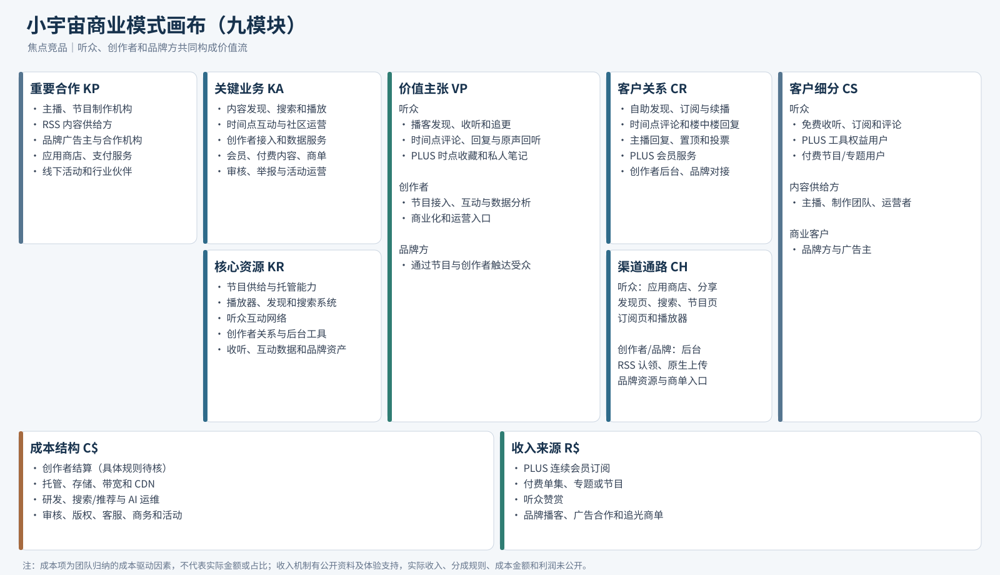

# 深度内容思考与共鸣社区：竞品选择与商业模式评估报告

> 课程作业整合稿 v0.4（图表整合稿）
> 
> 日期：2026-11-15｜负责人：M1
> 
> 课程焦点竞品：小宇宙
> 
> 研究范围：深度内容消费之后的片段捕捉、来源保留、个人理解、检索回顾，以及可能发生的主题交流
> 
> 写作说明：本报告整合团队已完成并交叉审计的用户访谈、竞品研究、商业模式画布和外部环境研究。真实访谈、产品实测、公开资料和研究推断分别表述，不把阶段性假设写成已验证事实。

## 摘要

播客、书籍和长文章的价值并不止于完成一次收听或阅读。用户可能在某个具体片段上产生共鸣、疑问或新的理解，之后希望保留内容出处、记下自己的想法，并在需要时重新找到原文。部分用户还会把观点分享给朋友，或希望得到进一步回应。但这些行为往往分散在内容平台的收藏和评论、截图、个人笔记以及即时通信工具中。问题不是市场上缺少收藏、批注或讨论功能，而是用户需要自行连接内容片段、来源、个人理解和后续交流。

团队通过 8 份真实访谈、16 份 AI 模拟访谈、十款代表产品的竞品研究及小宇宙商业模式分析，对这一问题域进行了探索。真实访谈显示，部分受访者有保存、分享、回找或讨论经历，也有人认为现有工具足够，或不愿为低频记录额外安装应用。AI 模拟材料仅用于提出反例和补充问题，不计入真实样本。竞品研究则表明，片段捕捉、出处定位、个人笔记和作品讨论均已有成熟产品覆盖，不能把某个单项功能缺失当作市场空白。

本报告选择小宇宙作为课程焦点竞品。它把播客发现、收听、时间点评论、原声回听、主播互动和创作者运营工具结合起来，适合分析深度内容消费与交流场景中的多边商业模式。报告进一步分析小宇宙九模块商业模式画布、价值主张 SWOT、用户界面/基础设施/收入与支出的总体评估，以及市场影响力、行业影响力、关键趋势和宏观经济影响共 18 个外部环境子方向。

研究收束后的价值优先级是：**P0 个人观点沉淀；P1 轻量主题讨论，作为可能的差异化方向；P2 完整社区生态暂缓。**P0 指轻量保存有价值的内容片段及出处/定位，允许用户补充个人理解，并支持检索和回看。P1 不是所有用户的必经流程，而是对有交流意愿的用户提供的可选增量；其相对原平台评论、熟人聊天和现有社区的增量价值仍待验证。P2 所涉及的大规模公共信息流、复杂推荐、关系网络和成熟社区治理不在本阶段冻结。

因此，本组当前提出的价值主张不是再做一个播放器、通用收藏夹或纯笔记软件，而是帮助用户把深度内容中的片段、来源与自己的理解组织成可持续回顾的个人观点资产；在此基础上，再验证轻量主题讨论能否为部分用户带来额外价值。

---

## 1. 选题与价值创造：从深度内容消费到个人观点沉淀

### 1.1 问题域：内容消费之后发生了什么

用户收听一段播客、读完一章书或浏览一篇长文章时，可能遇到一个值得记住的观点。这个观点不一定马上形成完整笔记：有时只是想保存一句话，有时想记下自己的反应，有时希望以后能找到原文，有时则想把它分享给朋友。内容消费之后的任务因此至少包含三个相互关联的环节：

- **捕捉内容：**留下真正触发思考的片段，而不是只收藏整本书、整篇文章或整期节目；
- **保留上下文：**记录足以回到原始内容的信息，例如原文链接、播客时间点、书籍页码或内容标题；
- **沉淀个人理解：**将自己的解释、疑问或联想与原始内容区分开来，便于之后检索和回顾。

交流是另一种可能发生的后续行为，但并非每次内容消费都会进入讨论。用户可能只想保存，可能在熟人聊天中分享，也可能在原平台评论区表达。只有部分用户会希望把观点带到一个新的主题空间，与不止一位熟人持续讨论。因此，研究需要区分个人沉淀任务与主题讨论需求，不能把二者合并成一个所有用户都必须完成的流程。

现有工具分别承担了这些任务。小宇宙提供播客收听、时间点评论和原声回听；微信读书把划线、笔记与书友想法连接起来；Snipd、Readwise Reader 和 Cubox 提供不同形式的内容捕捉和来源定位；flomo、Obsidian 等工具支持个人记录与知识组织；微信、QQ、豆瓣和即刻则可以承接分享与交流。用户可以组合这些工具完成任务，但需要自己在不同入口之间复制、转发、补充背景或重新整理。

由此，本组研究的并不是“用户没有地方收藏内容”，而是一个更具体的问题：**当用户想把深度内容中的某个片段与自己的理解一起留下来时，现有工具组合是否足够轻量、可靠，并能支持之后的检索和回看？对有交流意愿的用户，围绕具体观点的主题讨论是否能在此基础上增加价值？**

### 1.2 用户研究：真实行为与反向证据并存

团队完成了 8 份真实访谈，采用便利抽样。访谈适合帮助我们理解受访者的具体行为、替代方案和异议，但样本规模及抽样方式不支持推断大学生或播客用户总体中的需求比例。另有 16 份 AI 模拟访谈，仅用于探索潜在反对意见、完善追问和补充情境，不作为真实用户样本，也不用于证明市场需求。[27,33]

八份真实访谈呈现出不同的内容习惯和任务：

| 访谈 | 受访者描述的实际行为 | 对本项目的启示与限制 |
|---|---|---|
| U01 | 关注 AI 和软件工程相关观点，会浏览社交媒体并与朋友、同学交流；更希望看到高质量观点，主动表达意愿较低 | 说明观点发现和质量筛选可能是需求，但没有明确的片段保存或个人笔记需求 |
| U02 | 阅读自动化专业书籍，使用平板笔记软件或 WPS 记录，并整理 PID 与 PLC 的概念关系 | 说明个人知识整理确实存在；同时也是重要反例：现有工具方便够用，没有明显检索或交流困难 |
| U03 | 将一段趣味文案转发给朋友，后来翻聊天记录找过一次；手机笔记能记录想法，却不便同时保留触发想法的内容背景 | 说明分享内容与个人想法可能分散，但该案例是趣味文案分享，不应直接等同于深度知识管理 |
| U04 | 看到人物事迹短视频后点赞、进一步了解，并通过抖音分享给朋友、进行简单交流 | 说明内容可能触发延伸了解和分享；但原始出处是否保留、是否发生实际回找困难均未明确 |
| U05 | 听民俗播客后收藏整集、发朋友圈并与室友讨论；打开备忘录记录灵感时，有时会失去当下的想法 | 说明收听当下的轻量捕捉可能有价值；但受访者认为收藏回找方便，也不太会在新记录工具中讨论 |
| U06 | 阅读观点后记入备忘录，并在课堂讨论中使用 | 说明个人记录可以进入线下交流；但受访者认为偶尔记录不值得额外安装 App，现有方式基本够用 |
| U07 | 阅读小说片段后评论、截图并通过微信分享；记录显示截图可能不便保留出处 | 说明作品片段可能同时触发表达和分享；该记录存在归纳归属及体验日期问题，相关实测细节不作为强证据 |
| U08 | 曾因公众号观点产生印象，但没有保存；也有把视频带入线下交流的经历 | 说明分享和交流行为存在；但“之后可能难以回找”是预测，不是已经发生的失败经历 |

从这些案例可以看到，用户需求并不集中在同一个功能上。U02 已经建立稳定的个人笔记习惯，现有工具足以满足；U01 更重视获取高质量观点，而不是自己记录；U03 的分享和回找问题存在，但其记录意愿不强；U05、U06 有内容保存或讨论经历，却不一定愿意在新的工具中讨论。U04 和 U08 的分享行为也不能自动推导为加入陌生人社区的意愿。U07 的记录存在质量问题，因此报告只保留其主记录中可确认的行为，不把存在疑点的归纳段作为独立证据。[27,31]

这些反向证据提醒我们：认可某个产品概念，不等于用户已经遇到足够强的痛点；有分享行为，不等于愿意迁移到新的社区；现有工具存在操作摩擦，也不等于用户愿意为减少摩擦而额外安装应用。对低频记录者而言，新的工具必须明显降低操作成本；对已有成熟笔记体系的用户而言，单纯增加一个记录入口很难形成迁移动机。

### 1.3 从访谈到研究裁定：P0、P1 与 P2

综合真实访谈、竞品能力和四位成员的交叉研究后，本组形成以下阶段性优先级：

| 优先级 | 方向 | 当前判断 | 证据状态 |
|---|---|---|---|
| P0 | 个人观点沉淀 | 第一优先级。轻量保存内容片段及出处/定位，可选记录自己的理解，并支持基本检索和回到原内容 | 多份真实访谈存在记录、分享或回找行为线索；但现有工具替代能力强，独立 App 采用意愿仍未验证 |
| P1 | 轻量主题讨论 | 可能的差异化方向。在个人沉淀基础上，允许有交流意愿的用户把观点带入主题讨论并获得回应 | 有真实交流行为和评论阅读数据作为线索；新社区迁移、持续参与及增量价值未证实 |
| P2 | 完整社区生态 | 暂缓。包括大规模公共信息流、复杂发现/推荐、完整关系网络及成熟治理体系 | 需要用户密度、持续参与和运营能力支撑，当前证据不足 |

这不是把产品永久定义为个人笔记工具，也不是因为课程选题名称中有“社区”就预设最终产品必须采用完整社区形态。P0 是本阶段最值得优先验证的独立价值；P1 是在 P0 基础上可以继续探索的增量；P2 则需要更强的用户密度和运营条件，暂不进入当前设计范围。[31]

据此，本组的阶段性价值主张可以表述为：

> 面向经常消费播客、书籍和长文章，并希望保留有价值观点的用户，优先帮助其轻量保存内容片段及出处/定位，补充自己的理解，并支持之后检索与回看；在此基础上，探索以主题为单位的轻量讨论能否为部分用户带来额外价值。

本阶段不冻结观点卡的详细字段、主题空间形态、成员关系、权限、通知、推荐、治理、自动跨内容关联或收费权益。这些属于后续产品定义和原型验证问题，不应在本次竞品与商业模式评估报告中写成已经确定的功能设计。[31,32]

---

## 2. 竞品选择与竞品生态：从单项功能比较到用户任务比较

**图 1｜竞品生态的任务覆盖矩阵**

### 2.1 为什么选择小宇宙作为课程焦点竞品

课程要求从所设想的价值创造出发，选择一个最贴合的已有软件产品，并对其完成完整商业模式画布。小宇宙是本组选择的焦点竞品，并不意味着它与本组设想完全相同，而是因为它最贴近深度内容消费后发生观点表达和交流的场景。

小宇宙不只是一个音频播放器。听众可以通过发现、搜索和订阅找到节目，在播放器中收听；在评论区围绕具体时间点表达观点，其他用户可以沿时间戳回到原声；主播也可以回复、置顶或组织互动。平台还面向创作者提供节目接入、数据看板和运营工具，并通过 PLUS、付费内容、赞赏和品牌合作等方式探索商业化。它因此同时包含内容消费、互动关系、创作者服务和商业合作，适合用于分析九模块商业模式画布。

选择小宇宙也有助于避免把市场机会描述得过于简单。它已经具备时间点评论和原声回听，说明“围绕某段内容讨论”并非空白功能；微信读书也能把原句、个人笔记和书友想法放在一起。若本组只提出增加收藏、批注或评论，就无法解释相对于已有产品的独特价值。我们需要研究的是不同产品分别承接了哪些用户任务，以及这些任务之间是否存在值得解决的衔接成本。

### 2.2 竞品生态：不同产品覆盖不同环节

本组没有把竞品限定为播客播放器，而是围绕用户从内容消费到个人沉淀和交流的任务链，选择十款代表产品进行比较。

| 竞品类别 | 代表产品 | 主要承接的任务 | 与本组研究的关系 |
|---|---|---|---|
| 内容消费平台 | 小宇宙、微信读书、喜马拉雅 | 发现和消费播客/书籍内容，围绕节目或原句发表评论、笔记和回应 | 直接场景参照；小宇宙为课程焦点竞品 |
| 内容捕捉工具 | Snipd、Readwise Reader、Cubox | 保存片段、标注、保留来源定位、跨来源汇集和回顾 | 个人内容捕捉与出处保留的能力参照 |
| 个人知识管理 | flomo、Obsidian | 记录个人想法、标签组织、搜索、链接和长期沉淀 | P0 个人观点沉淀的替代方案 |
| 内容与兴趣社区 | 豆瓣、即刻 | 围绕作品、兴趣小组或话题发布内容、评论和寻找同好 | P1 主题讨论的替代方案与组织方式参照 |

这些产品并不处在完全相同的市场中。内容平台首先解决内容消费问题，同时附带评论或笔记；捕捉工具和个人知识管理工具更重视保存、检索和回顾；内容社区则提供围绕作品或主题的公共交流。用户也可以不选择某一个“全能产品”，而是组合使用多个应用完成任务。因此，本组真正需要比较的竞争对象，既包括单个 App，也包括“原平台收藏 + 截图 + 个人笔记 + 微信/QQ 聊天”这样的现有工具组合。[28,29]

### 2.3 关键竞品的任务比较

**第一，内容捕捉与出处定位已经有成熟方案。**小宇宙的时间点评论可以将文字与音频时刻关联，点击时间戳可以回到原声；微信读书可以对原句划线并写笔记，之后从笔记回到对应段落。Snipd 支持保存带时间戳的播客片段和 Deep Link；Readwise Reader 的受测路径支持中文播客转录与段落级时间戳，但回放发生在 Reader 内部；Cubox 可以保存网页快照并在自身产品内定位到句子，但本次受测路径跳回微信原网页时只回到页面顶部。[28,29]

这些差异说明，捕捉能力需要结合来源类型和回到原文的路径评价。时间戳、段落定位和网页快照并非同一种能力，也不能仅凭“支持高亮”就认定来源上下文完整。更重要的是，Snipd、Reader、Cubox 等工具已经覆盖了相当一部分捕捉与回顾任务，本组不能将“保存片段”本身视为独占创新。

**第二，个人观点整理也不是空白领域。**flomo 以快速记录和标签回顾为主要使用方式；Obsidian 强调本地 Markdown 文件、双向链接和知识组织；Readwise Reader 将阅读、标注和回顾连接起来。对于已经有成熟记录习惯的用户，新增一个个人笔记工具必须证明它能降低现有工作流成本，或者解决现有工具难以完成的特定任务。U02 的访谈正好提供了反例：受访者已有平板笔记和 WPS 的使用习惯，没有明确的检索或整理痛点。[27,28]

**第三，讨论能力已经存在，但组织单位不同。**小宇宙的讨论主要依附于播客单集和音频时间点；微信读书围绕书籍原句和书友想法组织交流；喜马拉雅提供单集评论；豆瓣围绕作品和小组， 即刻围绕动态与话题形成兴趣交流。它们分别能满足部分讨论需求。微信群聊和线下交流则更适合熟人关系中的即时沟通。不能因为本组希望探索主题讨论，就声称市场上没有评论区或讨论社区。[29]

**第四，跨环节衔接是一个需要验证的组合问题。**在本次受测路径中，内容平台的讨论与平台内内容紧密相连，个人知识管理工具擅长长期记录，兴趣社区擅长聚集同好；但没有一条受测路径能够完整展示“跨来源片段及出处—个人理解—检索回顾—可选主题交流”全部环节。这个观察只说明现有产品在本次研究范围内各有侧重，不能证明市场上绝对不存在类似产品，也不能直接证明用户愿意采用新的工具。

### 2.4 竞品比较带来的结论：差异化必须落在工作流，而不是功能清单

将竞品放在一起看，用户并不缺少收藏、批注、笔记或评论工具。真正值得研究的是：用户能否以较低成本把来自不同内容平台的片段和出处带入个人空间，附上自己的理解，并在之后可靠地找回。对于有交流意愿的用户，观点能否进一步进入一个有主题、有上下文的讨论场景，是 P1 的候选问题。

因此，本组的差异化假设不是“创造收藏”“创造评论”或“创造知识图谱”，而是降低用户在现有工具之间拼接任务的成本。P0 要先证明个人沉淀工作流相对现有工具组合更顺畅；P1 再证明轻量主题讨论比原平台评论或熟人聊天产生增量价值。若这两项都不能通过实际任务验证，产品就没有理由仅凭功能组合看起来更完整而要求用户迁移。[31,32]

---

## 3. 小宇宙完整商业模式画布

**图 2｜小宇宙商业模式画布（九模块）**

小宇宙的商业模式并非只面向听众。平台连接听众、主播和节目制作团队、品牌方以及外部内容和支付渠道：创作者提供节目，平台完成内容发现、分发、播放和互动；听众贡献收听时间、订阅、评论和反馈，部分用户购买会员或付费内容；品牌方通过节目和创作者触达特定听众。以下九个模块是团队依据公开资料、产品体验和成员研究形成的商业模式归纳，不代表小宇宙官方内部经营数据披露。[30]

### 3.1 客户细分（Customer Segments）

小宇宙至少连接三类主要客户。

第一类是听众。听众通过平台发现、收听和追更节目，其中既包括使用免费收听、订阅和评论功能的用户，也包括购买 PLUS 工具权益或付费内容的用户。不同听众的使用深度不同：有人只收听，有人会查看评论，有人会主动发表评论或使用时点记录。行业调查显示，收听时阅读评论与主动写评论是不同参与行为，不能把所有听众视为同一种社区参与者。[7]

第二类是主播、节目制作团队和运营者。他们通过 RSS 认领或原生上传接入节目，使用后台进行节目管理、数据查看、评论互动和运营。创作者既是内容供给方，也是平台创作者工具和商业化服务的使用者。

第三类是品牌方或广告主。他们有播客投放、品牌内容或创作者合作需求，希望通过节目和主播触达特定受众。品牌方与普通听众的付费动机不同，不能把会员收入和品牌合作收入合并理解。

目前公开资料和团队研究能够确认这些客户类型及对应入口，但无法确认听众总规模、PLUS 付费用户占比、活跃创作者数量、品牌客户数量或不同客户的收入贡献。

### 3.2 价值主张（Value Propositions）

对听众，小宇宙提供播客发现、收听和追更体验，并通过时间点评论、回复、高能点赞和时间戳回听，让用户能够围绕某个音频时刻表达感受或阅读他人的观点。PLUS 公开权益还包括私人时点笔记等工具。对创作者，平台提供节目接入和发布、听众互动、数据分析与运营工具，帮助主播持续触达听众并理解节目反馈。对品牌方，平台通过品牌资源入口和追光商单等合作机制，提供节目合作和受众触达渠道。[16-19,30]

时间点互动是小宇宙听众侧较有辨识度的价值：评论不只是脱离内容的文字，而是能与音频的具体位置关联。其他听众可以点击时间戳回到原声，主播也可以在相同上下文中回复。但功能存在不等于已经证明它提高了留存、付费或创作者收入；这些经营效果没有公开数据支持。

### 3.3 渠道通路（Channels）

听众通过应用商店、站外分享、发现页、搜索、节目页、订阅页和播放器接触平台。发现页与搜索帮助用户找到节目，节目页帮助判断内容是否值得收听，订阅页帮助追更，播放器负责音频交付和收听进度。M2 的一次安卓端体验走通了搜索、订阅、暂停续播和从评论时间戳回听的路径，但这只是单次体验，不能代表所有新用户的获客路径或推荐效果。[29]

创作者通过网页或客户端后台、RSS 认领和原生上传接入平台；品牌方则可以通过品牌资源页和追光商单等入口寻找合作。不同渠道承担的功能不同：应用商店和站外分享负责触达，搜索和节目页帮助筛选内容，订阅与播放器负责持续交付，后台和商务入口服务创作者及品牌方。

### 3.4 客户关系（Customer Relationships）

听众侧以自助发现、订阅更新和续播维持日常关系；时间点评论、楼中楼回复、高能点赞和主播互动形成平台内社区关系；PLUS 则为有持续整理需求的用户提供会员服务。创作者侧通过后台数据、评论管理、投票和公告等工具经营节目与听众关系。品牌合作则更接近项目制服务，需要平台、品牌和创作者之间进行商务对接。[29,30]

时间点评论的关系价值在于让发言者、回复者和后来阅读评论的人共享同一段音频上下文。M2 的一次体验从评论时间戳回到音频，并在约一小时后从“我的评论”找回自己的记录，说明短时回访路径可以完成；但不能据此推断长期留存、用户忠诚度或社区网络效应已经形成。

### 3.5 收入来源（Revenue Streams）

目前能够确认的商业化机制包括 PLUS 连续会员订阅、付费单集/专题/节目、听众赞赏，以及品牌播客和追光商单合作。它们对应不同付款主体：会员和付费内容主要由听众付费，赞赏是听众对创作者的支持，品牌合作则由广告主或合作方提供预算。[16-19,30]

M2 于 2026 年 11 月 11 日在安卓端观察到 PLUS 连续包月 15 元、连续包年 120 元的页面价格。该信息只能说明当时该账号看到的标价和订阅入口存在，不能代表平台实际净收入。会员人数、转化率、续费率、退款率、各端收入占比、品牌服务费和平台分成均没有可核实的完整数据。

### 3.6 核心资源（Key Resources）

小宇宙的核心资源包括通过 RSS 和原生托管形成的节目供给、播放器与发现/搜索系统、听众互动网络、创作者关系、创作者后台和数据看板，以及播客大赏、线下活动和品牌资源所积累的品牌资产。创作者后台的数据类型涉及节目订阅、播放、收听时长、听众画像、单集完播率、留存曲线和互动表现；这些数据可以帮助创作者理解节目反馈。[30]

其中，内容供给具有开放性：创作者可以通过 RSS 接入，也可以原生托管。这有利于扩充节目来源，但意味着平台未必拥有节目版权或独家供给。RSS 可能降低部分内容获取成本，却不能推导出平台整体成本低，因为托管、带宽、版权、审核和运营支出仍然存在。

### 3.7 关键业务（Key Activities）

小宇宙需要持续开展内容发现与推荐、节目分发和播放、时间点互动与社区运营、创作者服务、会员和付费内容运营、赞赏及品牌商单支持，以及内容治理和举报处理。平台的业务不止于音频播放：评论区需要维护，创作者需要数据和工具，品牌合作需要商务对接，付费内容和用户生成内容也需要相应规则与治理。

这些活动之间存在依赖关系。内容发现帮助节目获得播放，播放和互动产生听众反馈，创作者工具帮助主播理解反馈并调整内容，商业化机制则把会员、内容交易和品牌预算转化为收入。治理活动贯穿其中，保证内容和互动在规则范围内运行。

### 3.8 重要合作（Key Partnerships）

小宇宙需要与主播、节目制作机构和 RSS 内容供给方保持关系；品牌广告主及合作机构为商业合作提供需求；应用商店、支付服务和技术基础设施为分发与交易提供外部支持；播客大赏、线下活动和行业合作方则有助于维护创作者关系和品牌影响力。[30]

开放 RSS 降低了创作者接入门槛，但也使创作者可以多平台分发，平台对独家内容的控制有限。Apple 是 iOS 分发和内购渠道之一，但安卓端另有支付路径，因此不能把单一渠道规则直接扩大为小宇宙整体对 Apple 的依赖。监管机构会影响内容治理和合规要求，但在没有双边合作证据时，应将其作为外部环境因素，而非商业合作伙伴。

### 3.9 成本结构（Cost Structure）

根据平台业务活动，可以识别出若干可能的成本驱动因素：创作者结算与内容分成、应用商店和支付渠道费用、音频托管与存储、带宽和 CDN、产品研发与技术运维、推荐和 AI 能力、内容审核与版权合规、创作者运营、品牌商务、客服、市场推广及线下活动。这些是依据业务模式推断的成本类别，并非已披露的实际支出。[30]

目前无法确认各项成本金额、费率、人员规模和利润率。尤其不能把其他平台的分成比例或渠道费率套用到小宇宙，也不能因为 RSS 接入就认定其整体商业模式具有低成本优势。完整 BMC 的财务部分应保留未知项，而不是为了填满画布而补造数字。

### 3.10 九个模块之间的价值流动

小宇宙的价值流从创作者供给开始：主播通过 RSS 或原生托管提供节目，平台借助发现、搜索和播放器触达听众；听众贡献收听时间、订阅、评论、点赞和分享，互动又为主播带来反馈和社区关系；创作者通过付费内容、赞赏或品牌合作获得收益；品牌方借助节目和主播触达听众，并为合作投入预算。平台通过会员、内容交易和商业合作形成收入，同时承担创作者结算、渠道、技术、治理和运营等成本。

这条价值流说明，小宇宙的商业模式不是某个孤立功能，而是内容供给、听众互动、创作者运营和商业化机制的组合。后续总体评估需要判断这套组合在哪些环节形成优势，又在哪些外部条件下受到限制。

---

## 4. 总体评估与 SWOT

**图 3｜总体评估与价值主张 SWOT**

课程要求从竞品商业模式画布切分出的价值主张、用户界面、基础设施、收入与支出四部分进行总体评估，并选择其中一部分深入 SWOT。本组选择**价值主张**作为深入方向。SWOT 中，S/W 是小宇宙内部价值主张的优势与弱点，O/T 则来自外部市场环境；不能把所有观察到的不足都直接写成外部威胁，也不能把市场机会写成平台自身优势。

### 4.1 价值主张：深入 SWOT

小宇宙最明确的内部优势，是把评论与具体音频时刻连接起来。听众可以围绕某个时间点表达感受，其他用户能够点击时间戳回到原声，主播也可以回复、置顶或组织投票。这样，评论不只是脱离内容的文字，而是附着在同一段声音上的交流。M2 的单次体验验证了从评论跳回音频和之后找回评论的路径；M3 的后台体验补充了主播管理评论、查看数据和组织互动的工具。这些证据支持“功能路径存在”，但尚不能证明它带来更高留存或付费转化。[29,30]

它的弱点更多体现为场景边界，而不是功能缺失。时间点评论主要围绕播客单集组织；如果用户想把播客、书籍和文章中的观点放在一起管理，仍可能需要借助外部工具。私人时点笔记被列为 PLUS 权益，意味着公开评论和付费用户的私人记录承担不同任务；站外分享能带出节目、观点和时间戳，但本次没有完整验证分享后能否直达原讨论上下文。以上都不等于小宇宙绝对无法做跨来源管理，而是现有证据未将其确认为核心流程。[29,30]

外部机会来自两类事实。第一，2024 年中文播客调查中，54.6% 的受访听众表示会看评论，19.4% 表示会写评论，两种行为可以重叠。这说明阅读讨论的人多于主动发言者，讨论内容有机会同时服务发言者和旁听者。[7]第二，八份真实访谈中，多位受访者有分享、讨论或期待回应的经历，交流发生在平台评论、熟人聊天、课堂和线下场景。它们说明内容交流有现实基础，但不能证明这些用户会加入一个新的独立社区。[27,31]

外部威胁则来自注意力竞争和替代渠道。2024 年调查显示，过半受访者订阅超过十档节目，但每周定期收听十档及以上者不足 5%；用户订阅多，并不意味着有足够时间消费每一期内容。[7]小宇宙还面临喜马拉雅、网易云音乐、Apple Podcasts 和视频平台等不同形态的竞争；在讨论环节，微信读书、豆瓣、即刻和微信群聊也可以完成部分任务。由此形成的 SWOT 结论是：小宇宙在播客内部拥有较清晰的互动价值，但其内容组织方式并不等同于跨来源观点沉淀；本组若要进入这一领域，必须证明新的工作流比现有平台与个人工具组合更有增量价值。

| 分类 | 核心判断 | 证据边界 |
|---|---|---|
| S1 | 评论与原声时刻绑定，讨论可回到具体音频 | 单账号、单集体验，未证明长期留存提升 |
| S2 | 主播可通过回复、置顶、投票和后台工具组织互动 | 未测互动率和运营效果 |
| S3 | 搜索、订阅、播放和评论回听链路较完整 | 仅覆盖一次用户旅程 |
| W1 | 互动主要围绕播客单集组织，跨来源观点管理不是本次核实到的核心流程 | 产品边界，不等于绝对能力缺失 |
| W2 | 私人时点笔记列入 PLUS 权益 | 不同端权益和价格需动态复核 |
| W3 | 站外分享后的原讨论回流路径尚未完整验证 | 单次观察 |
| O1 | 受访听众看评论的比例高于主动写评论的比例 | 行业自报样本，不代表小宇宙用户比例 |
| O2 | 部分用户已有内容分享、交流和回应行为 | 8 份便利样本，不代表总体需求 |
| T1 | 听众注意力有限，订阅量不等于实际收听量 | 历史问卷自报数据，不是平台日志 |
| T2 | 内容平台、笔记工具和沟通渠道形成强替代 | 替代路径存在不等于用户一定迁移 |

### 4.2 用户界面：基础链路较完整，局部摩擦集中在发现和私密记录

从客户细分看，小宇宙同时服务免费听众、会员用户、主播和品牌方，平台为不同参与者提供相应入口。听众可以免费收听、订阅和评论；持续整理需求较强的用户可以考虑 PLUS；主播通过后台管理节目和互动；品牌方则通过品牌资源和商单入口寻找合作。

从渠道通路看，搜索、订阅页和播放器分别承接选集、追更和续播。M2 的一次体验中，用户没有从发现页立即找到感兴趣的节目，转而搜索“音乐”后找到相关单集；订阅后能够看到更新，暂停退出后也能从原位置续播。这说明平台具备基本的发现与交付能力，但一次首访不能代表推荐系统整体效果。分享图可以把节目、观点和时间点带到站外，但回到 App 并继续参与原讨论的路径尚未完全核实。[29]

从客户关系看，时间点评论和主播回复提供了共同语境；一小时后的回访也验证了短时找回路径。相对地，非会员在本次路径中没有找到同粒度的私人时点记录入口，而官方将私人时点笔记列为 PLUS 权益。综合而言，客户界面已有完整的基础链路，局部摩擦集中在首访兴趣匹配、非会员私密记录和站外回流。没有获客成本、长期留存率和品牌忠诚度数据，不能据此推断客户界面已经带来更高盈利。

### 4.3 基础设施：开放供给与创作者工具是优势，独家性和治理成本是约束

小宇宙的基础设施优势主要来自内容供给、互动网络和创作者工具。RSS 与原生托管提供多路径节目接入；时间点评论、高能点赞、楼中楼回复和主播互动形成社区网络；创作者后台提供节目管理、听众数据、单集表现和收益入口。播客大赏、线下活动和品牌资源页则帮助平台维持行业影响力与创作者关系。[30]

但开放生态同时带来约束。创作者可以多平台分发，平台对独家内容的控制力有限；RSS 与原生托管并存，意味着平台不一定拥有节目版权。后台数据虽然丰富，但目前没有证据证明它已经成为独立对外数据产品或稳定收入来源。评论、用户上传内容和创作者服务也带来审核、举报和合规工作，实际治理成本未知。因而，基础设施的净判断是：小宇宙的优势在社区互动、创作者运营和数据看板，弱点在供给独家性和对外部渠道的控制；不能把开放 RSS 直接解释成整体成本优势。

### 4.4 收入与支出：商业化机制多元，但盈利能力无法从公开信息判断

小宇宙已形成会员订阅、付费内容、听众赞赏和品牌合作等收入机制，覆盖不同付费主体。PLUS 提供持续订阅路径，付费单集和专题让听众按内容付费，赞赏为创作者提供支持入口，追光商单连接品牌预算和节目创作者。多元收入机制是商业模式的积极因素。[16-19,30]

问题在于，公开资料没有提供可核验的总收入、成本、利润、付费用户数和收入结构。创作者分成、支付渠道费率、品牌合作服务费、广告主数量、复购率和投放效果都缺少完整证据。音频托管、存储、带宽、研发、AI、审核、版权、客服和品牌运营可能形成持续成本，但金额未知。会员标价不能替代转化率、续费率、用户生命周期价值或获客回收期。因此，本组只能确认商业化机制存在，不能判断哪条收入流最大、平台净收入如何确认，或平台是否盈利。

### 4.5 四部分评估的综合结论

四部分不是彼此独立的打分表。价值主张决定用户为什么来；用户界面决定价值如何被发现、交付和持续使用；基础设施决定平台能否稳定提供内容、互动和创作者服务；收入与支出则决定这种服务能否形成可持续的资金循环。小宇宙在播客内容、互动和创作者工具之间已经形成组合优势，但跨来源组织、创作者绑定、治理成本和财务透明度仍存在边界。后续蓝海战略应当从价值主张切入，而不是简单增加一个评论功能或复制现有播放器。

---

## 5. 商业模式外部环境：18 项分析

本章按照课程要求，依次分析市场影响力 5 项、行业影响力 5 项、关键趋势 4 项和宏观经济影响 4 项。每项都围绕小宇宙现有商业模式展开，说明外部条件如何影响客户、价值主张、合作、收入或成本。课程文件要求尽量回答教材在各子方向列举的主要问题；目前团队已核对课件中的 18 个子方向名称，但未取得教材逐项“主要问题”的完整原文，因此下文的问题表述是研究者根据课程子方向作出的具体化，不冒称教材原文。[34-36]

### 5.1 市场影响力（5 项）

#### 5.1.1 市场分类

播客听众并不是同一种使用方式的人群。2024 年中文播客调查中，54.6% 的受访听众表示会在收听单期时看评论，19.4% 表示会写评论，两种行为可以重叠。[7]这意味着平台面对的不只有主动表达者，也有通过阅读他人评论理解节目、判断是否值得收听的旁听者。M2 的一次体验也显示，同一用户会先搜索节目、再收听、发表评论并查看主播回复。[29]

对小宇宙而言，客户细分可以按任务区分为发现节目、追更节目、阅读讨论和主动表达，而不必把用户永久划为互斥类型。品牌方和创作者则属于不同的客户侧参与者，不能与听众会员混为一谈。上述数据来自行业自报样本，不能直接当作小宇宙用户构成，也无法据此判断哪一类用户贡献收入最高。

#### 5.1.2 需求和诉求

用户需要的不只是“听到内容”，还可能包括回到某个声音时刻、私下记下一句话，或把一个观点带给朋友。U05 听播客后收藏、分享并与室友讨论，认为收藏回找方便，但在打开备忘录记录灵感时可能失去当下的感受；M2 的一次实测则从时间戳评论回听原声，并在约一小时后找回自己的记录。小宇宙 PLUS 公开说明还列有私人时点笔记。[17,29]

这些行为对应三个不同任务：重听原声、个人回顾和向他人分享。平台可以通过时间点评论、私人记录和分享入口分别承接，但不能默认所有用户都希望公开表达。真实访谈同时存在现有工具足够、低频记录不值得安装新应用等反例。因此，需求机会在于降低记录与回顾摩擦，而不是强迫所有用户进入社区。

#### 5.1.3 市场问题

内容供给丰富并不意味着听众有足够时间消费。2024 年调查中，过半受访者订阅超过十档节目，但每周定期收听十档及以上者不足 5%。[7]这说明订阅数量与实际收听之间可能存在差距。M2 的一次首访中，用户没有直接从发现页找到感兴趣的节目，而是输入“音乐”后才选中某一单集。[29]

对于小宇宙，节目标题、主题搜索、推荐和订阅更新分别影响新用户发现和老用户追更。平台不仅要让用户订阅节目，还要让单集在有限的收听时间中被选中。有限注意力是威胁；帮助用户理解某一集为何值得收听，则是产品机会。但调查数据不是平台日志，单次搜索体验也不能评价推荐系统的整体效果。

#### 5.1.4 切换成本

只更换播放器的成本可能不高，因为同一节目可以通过不同平台发现和收听；真正可能形成回访理由的，是已经积累的评论、私人记录和时间点。M2 在小宇宙从“我的评论”找回秒数，在微信读书从笔记回到原句；U05 则把收藏、记录和熟人讨论分散在不同入口。小宇宙提供订阅列表导入，降低了部分收听迁移成本，但这不能证明评论和个人记录也能同步迁移。[29]

因此，平台的切换成本不应只看用户是否能换一个播放器，还要看内容、评论和个人想法能否一并带走。用户也可能同时使用多个平台，而不是完全迁移。当前没有同一批记录跨平台迁移的实测，不能量化用户锁定程度。

#### 5.1.5 收入吸引力

播客商业化存在多种付费动机：听众可以为某一档节目或内容付费，也可以为持续使用的工具权益订阅，品牌方则为节目合作和受众触达投入预算。小宇宙公开提供 PLUS、付费内容和品牌合作入口；M2 在安卓端记录到 PLUS 连续包月 15 元、连续包年 120 元的页面价格。[16,17,19,29]

但节目付费不等于工具订阅意愿，会员标价也不等于实际收入。M2 的非会员账号已经完成一次公开评论和回找，没有发生支付。平台会员转化率、续费率、品牌合作收入和分成规则均未知。收入吸引力的机会在于不同价值对应不同付款主体；威胁在于免费替代路径充分，用户可能只为内容付费而不为整理工具付费。

### 5.2 行业影响力（5 项）

#### 5.2.1 主流竞争对手

小宇宙所处的播客行业并非只有垂直播客应用。喜马拉雅拥有综合音频内容、主播运营和会员商业化体系；网易云音乐可以利用音乐社区、独家 IP 和既有用户流量拓展播客；Apple Podcasts 提供系统级播客入口；B 站则通过视频播客争夺创作者和用户注意力。[13-16,35]

这些竞争者的优势并不相同：综合音频平台的内容库和变现体系更广，音乐平台具有社区流量，系统级入口具有分发优势，视频平台具有流量和视频化制作资源。小宇宙的差异在于垂直播客体验、时间点互动和社区氛围。对其而言，威胁来自内容供给、创作者和品牌预算被不同平台分流；机会则是继续服务重视纯音频和时间点互动的听众。

#### 5.2.2 新进入者与挑战者

视频播客正在改变内容生产和分发方式。B 站公布过视频播客消费时长增长及创作者扶持计划，小红书、抖音精选和腾讯视频也推出视频播客相关活动或频道。[15,35]这些平台不一定以传统播客应用的方式竞争，而是通过流量、视频制作工具、平台补贴或分账机制吸引创作者。

与此同时，第三方工具也在进入播客后处理环节。Readwise Reader 的受测路径支持中文播客转录和段落级时间戳；Snipd 在本次受测版本中的 AI 语言列表不含中文。[20,21,28]这说明播客的转录、摘要和片段管理正在成为独立工具的竞争领域。挑战者的威胁在于改变内容分发与创作者变现规则；机会在于视频化制作成本较高，中尾部创作者仍可能需要低成本音频阵地。

#### 5.2.3 替代产品和服务

小宇宙争夺的不只是其他播客应用的用户，也包括用户可支配的注意力。2025 年 6 月，短视频、网络音乐和长视频分别拥有较大的网民使用规模；短视频使用率达到 95.1%，网络音乐为 64.5%，长视频为 62.4%。[35]这些数字不等于播客用户迁移比例，但说明听众有大量替代内容形态。

在讨论任务上，用户也可以通过微信读书书友想法、豆瓣作品评论、即刻话题或微信群聊交流。替代产品可能不提供完全相同的上下文，但如果用户只想表达感受或得到朋友回应，现有工具已经足够方便。因此，播客平台必须解释自身讨论体验相对于短视频、社交平台和熟人沟通的独特价值。

#### 5.2.4 供应链与价值链上的其他厂商

小宇宙的价值链包括内容创作者和制作机构、RSS 与托管服务、音频存储和分发、应用商店与支付渠道，以及品牌广告主和商务合作方。创作者提供节目，平台完成托管或聚合、发现、播放和互动；品牌方提供预算，平台和创作者通过节目合作触达听众。创作者多平台分发已较常见，制作机构也可能同时与不同音视频平台合作。[30,35]

这使平台在供给端拥有开放性，但缺乏强独家控制。应用商店和支付渠道会影响分发和交易规则；云、带宽、存储和 CDN 是技术成本驱动因素；品牌方则影响商业化收入。各渠道费率、合同关系和实际成本尚未完整核实，因此只能判断价值链上的依赖类型，不能计算平台净收入或成本优势。

#### 5.2.5 利益相关者

对小宇宙影响较大的利益相关者包括核心创作者和节目机构、品牌广告主、普通听众、应用商店与支付渠道，以及内容监管机构。创作者决定内容供给和节目更新；品牌广告主影响商业合作预算；听众决定播放、互动和口碑；应用商店和支付渠道影响用户触达与交易；监管机构则规定内容治理和合规边界。[35]

这些参与者的权力和利益并不相同。核心创作者和品牌方对平台商业模式有较强影响，普通听众虽然单个用户的议价能力有限，却共同决定留存和口碑。Apple 是 iOS 分发和内购渠道之一，但小宇宙也存在安卓端支付路径，不能把 Apple 描述为全平台唯一渠道。监管机构属于外部约束，不应在缺乏双边合作证据时列入商业合作伙伴。

### 5.3 关键趋势（4 项）

#### 5.3.1 技术趋势

技术变化主要体现在三个方面。第一，视频播客供给和消费增长，音频平台也需要关注视频化内容形态；第二，中文播客转录、摘要和段落定位已进入第三方工具；第三，AI 生成音视频内容扩张，AI 总结也开始出现在播客会员权益中。[8,15,20,21,36]

这些变化为内容发现、检索、回顾和创作者运营提供机会，也带来低质生成内容、来源不清、摘要错误、版权和标识风险。视频化会提高制作、存储、带宽和审核复杂度；AI 能力则带来推理成本和质量控制问题。对本组而言，不能因为 AI 技术可用就把摘要、转录和自动关联全部放进首版，首先要验证观点捕捉、个人沉淀是否构成真实价值。

#### 5.3.2 行业管理与监管趋势

《人工智能生成合成内容标识办法》自 2025 年 9 月 1 日起施行，涉及显式标识和文件元数据隐式标识；《互联网信息服务算法推荐管理规定》要求适用服务建立算法审核、数据安全和个人信息保护制度，并向用户提供算法推荐告知及非个性化选项；著作权法对作品、表演和录音录像制品的信息网络传播等权利作出规定。[10-12,36]

对小宇宙而言，内容审核、版权授权、投诉处理和算法合规会影响关键业务与成本结构。对本组产品而言，保存观点时应优先保留来源元数据、链接、时间点或页码以及用户原创表达，不应默认复制和长期托管完整音频、文章或书籍内容。若后续引入 AI 摘要、转录或生成内容，还需核对相应标识和版权要求；若后续验证并纳入 P1 讨论，则需要进一步研究讨论内容的举报、删除和申诉机制。

#### 5.3.3 社会和文化趋势

复旦大学信息与传播研究中心发布的中文播客公共价值报告显示，18—35 岁听众占比较高，日均收听时长约 79 分钟；报告亦记录部分单集评论区出现多轮对话，重度用户的评论意愿更高。[6,36]这些数据说明，播客场景中确实存在愿意投入时间并参与讨论的群体。

但深度参与者并不代表所有听众。高质量讨论需要共同兴趣、参与者匹配和持续内容供给，社区规模扩大也可能带来低质量互动和治理成本。对本组而言，这些数据支持保留 P1 作为候选方向，但不能据此把讨论设计成所有用户的必经流程，也不能证明用户愿意迁移到一个新的独立社区。

#### 5.3.4 社会经济趋势

广义网络音频有年度付费用户和有声阅读市场收入数据；益普索 2025 年播客调查中，部分受访者自报 2024 年播客付费节目或专辑支出增加，也有部分受访者表示因播客广告或主播推荐而增加消费。[8,9,36]这些信息说明音频内容和播客商业化有市场基础，但网络音频年度付费用户、有声阅读市场收入和播客听众是不同统计口径，不能直接当作小宇宙自身的用户规模或本组产品的潜在付费用户。

因此，社会经济趋势带来的机会是用户对优质内容、工具和服务存在多种付费场景；威胁是不同人群的支付能力和付费动机差异很大。用户愿意购买某档节目，不代表愿意为观点沉淀工具或主题讨论付费；后续应针对具体权益进行真实价格测试。

### 5.4 宏观经济影响（4 项）

#### 5.4.1 全球市场情况

2025 年中国 GDP 初步核算增长 5.0%，居民人均教育文化娱乐支出增长 9.4%，文化服务业和文化新业态收入也保持增长。[1-3,36]这为播客内容、数字文化服务和品牌合作提供了广义产业背景。与此同时，宏观文化消费增长并不意味着每个内容平台都会受益，用户仍需在有限时间和预算中选择内容。上述统计覆盖多个文化行业，不能直接当作播客市场规模或小宇宙收入。

#### 5.4.2 大宗商品和其他资源

2025 年通信业云计算、大数据、移动物联网和数据中心等新兴业务收入增长，移动互联网流量和 5G 基础设施继续扩张。[4,36]这些资源有利于音频分发、内容检索、创作者后台和多端互动，也为本组产品的云存储和检索服务提供技术条件。

但基础设施扩张不代表云服务价格下降，也不代表平台的存储、带宽和 AI 成本可以忽略。小宇宙实际托管、带宽和审核成本没有公开；本组产品若不自建播放器，可以减少音频托管负担，但来源解析、链接维护、存储和检索仍会形成成本。

#### 5.4.3 资本市场

2025 年末社会融资规模存量按可比口径增长 8.3%，全年社融增量为 35.6 万亿元，企业贷款加权平均利率下降；IMF 指出，社融增长部分由政府债券发行推动，私人部门信用增长趋缓。[2,5,36]这说明宏观融资条件和政策支持并非完全收紧，但总量流动性宽松不代表早期消费互联网项目容易获得股权融资。

对小宇宙和本组产品而言，资本市场数据只能提供宏观背景，不能推断具体公司的融资能力、估值、现金流或盈利前景。项目仍需证明用户增长质量、持续使用价值和单位经济模型。

#### 5.4.4 经济基础设施

2025 年末中国互联网用户、5G 用户和移动互联网流量规模较大，移动网络、宽带和支付体系为音频播放、内容分享和会员交易提供了基础。[2,4,36]小宇宙已有 PLUS 和多端支付路径记录，说明用户能够通过成熟的移动支付渠道完成交易。

另一方面，应用商店、操作系统、支付渠道和平台 API 规则也会带来费用与依赖。不同终端的支付路径并不相同，小宇宙分端订单占比未知。基础设施普及只说明技术和交易条件具备，不证明用户一定有跨来源观点沉淀或主题讨论需求。

### 5.5 外部环境对商业模式的综合影响

18 项外部环境分析可以归纳为三条结论。

第一，内容消费和音频市场有规模，但竞争焦点是有限注意力，不是简单增加节目数量。小宇宙需要持续让用户在众多订阅和更新中选择节目，也需要面对短视频、音乐和长视频等替代内容形态。

第二，片段捕捉、AI 转录和个人知识管理的技术能力正在成熟，单项工具功能很难构成持久差异。平台如果只增加收藏、转录或摘要，容易被现有产品替代；真正需要比较的是用户能否以更低成本完成个人保存、来源回溯和回顾。

第三，播客听众中存在深度互动群体，但社区治理、内容版权、来源锚点和付费意愿都会影响产品可持续性。对小宇宙而言，这些条件影响其现有商业模式；对本组而言，它们提醒我们不能把 P1 讨论的潜在价值与运营成本分开讨论，更不能在需求尚未验证时提前建设 P2 完整社区。

---

## 6. 蓝海战略：围绕价值主张重组个人观点沉淀

**图 4｜价值主张 ERRC 四项行动框架**

**图 5｜本组候选商业模式画布（P0 / P1）**

### 6.1 从前期评估到战略问题

前面的研究说明，用户保存片段、标注出处、记录个人想法和参与讨论的能力已经分散在多个产品中。小宇宙在播客内部把评论和原声连接起来，微信读书把笔记和原句连接起来，Snipd、Readwise Reader 和 Cubox 提供捕捉与回顾，flomo 和 Obsidian 提供个人沉淀，豆瓣和即刻提供作品或话题讨论。若本组只是再做一个收藏夹或评论区，就很难说明为什么用户需要新产品。

本组已选择价值主张作为 SWOT 深入方向，因此蓝海战略也从价值主张切入。当前最值得验证的不是大规模社区，而是个人观点沉淀工作流：用户能否在遇到有价值的内容片段时，轻量保存片段和出处，补充自己的理解，并在之后检索和回看。P1 主题讨论可以作为后续差异化实验，但不能在证据不足时写成 P0 的必要组成。[31,32]

### 6.2 竞争要素与价值曲线

下表采用定性比较，呈现各类产品在不同任务上的主要提供水平。它不是用户量表评分，也不是同一条件下的量化竞品测试；“本组候选”首先表示 P0 设计目标，P1 只作为可选扩展。

| 竞争要素 | 内容平台 | 捕捉工具 | 个人知识管理 | 内容社区 | 本组 P0 候选 |
|---|---|---|---|---|---|
| 内容发现与消费 | 平台内较强 | 非核心 | 非核心 | 中等 | 不自建播放器 |
| 片段捕捉与来源定位 | 平台内较强 | 较强 | 依赖导入或手工 | 多为作品级 | 作为个人沉淀入口 |
| 个人理解沉淀 | 评论/批注 | 高亮/笔记 | 核心能力 | 动态/评论 | 与原始内容区分保存 |
| 跨来源统一检索 | 平台内有限 | 部分产品较强 | 依赖手工组织或导入 | 通常不是核心 | 作为待验证目标 |
| 主题空间与同好发现 | 平台内社区 | 非核心 | 非核心 | 核心能力 | P1 可选扩展，不列为 P0 必需 |
| 围绕具体观点讨论 | 单集或作品内 | 受测路径较弱 | 非核心 | 话题/作品级 | P1 候选，需验证增量价值 |
| 个人记录回顾 | 平台内记录 | 回顾工具 | 核心能力 | 依赖用户另行保存 | P0 目标能力 |
| 大规模信息流和关系网络 | 部分平台已有 | 非核心 | 非核心 | 较强 | P2 暂缓 |

本组不试图在内容发现、播放、转录、笔记或大规模社区运营方面全面超过已有产品。P0 的差异化目标在于将片段、来源和个人理解放在同一条轻量工作流中，降低用户在不同工具之间手工拼接的成本。P1 的主题讨论如果后续被验证，再作为增量价值加入，而不是预先抬高价值曲线。

### 6.3 ERRC 四项行动

**删除（Eliminate）。**删除自建播放器、音频托管和内容分发等与小宇宙、喜马拉雅正面竞争的基础设施；删除以粉丝数、流量和泛娱乐信息流为中心的增长方式；删除与个人观点沉淀无关的泛交友功能。这样做不是否定内容消费或交流的重要性，而是承认内容播放已有成熟平台，本组应集中资源解决内容之后的个人记录与回顾任务。

**消减（Reduce）。**减少强制长笔记、复杂标签、用户手工补齐全部来源字段和繁复的整理流程。真实访谈显示，用户记录频率和表达意愿差异明显；若每次保存都要求完整整理，产品会把新的负担转嫁给用户。对 P1 讨论也不预设复杂的关注关系、公开信息流或多层级社交结构；若后续进入验证，应从小规模、低复杂度的主题交流开始。

**提升（Raise）。**提升来源上下文的完整性，让观点尽可能保留原文链接、音频时间点或书籍页码；提升个人理解与原始内容的区分，让用户知道哪些是引用、哪些是自己的判断；提升检索、回顾和回到原内容的连贯性。这些能力不是完全空白的单项功能，而是需要在同一工作流中减少用户手工拼接。

**创造（Create）。**创造以内容片段、出处和个人理解为一体的跨来源观点条目，并形成轻量捕捉、检索和回顾工作流。对于有交流意愿的用户，可以进一步探索把观点分享给他人或带入主题讨论；但 P1 只有在对照原平台评论、微信群聊和现有社区后显示出增量价值，才进入后续产品范围。跨内容自动知识图谱、AI 摘要和完整社区治理均不是本阶段必须创造的能力。[32]

### 6.4 新商业模式画布

新方案的画布以 P0 个人观点沉淀为当前价值核心。P1 主题讨论作为待验证的可选扩展单独标注，P2 完整社区生态不纳入当前方案。

| BMC 模块 | P0 候选设计 | P1 可选扩展与待验证事项 |
|---|---|---|
| 客户细分 | 经常消费播客、书籍或长文章，并希望保存观点和出处的用户 | 对观点交流有明确意愿、希望围绕主题获得回应的用户；主题组织者是否构成独立客户待验证 |
| 价值主张 | 轻量保存内容片段及出处/定位，补充个人理解，并支持检索、回顾和回到原内容 | 把观点带入主题讨论并获得回应；需证明比原平台评论或熟人沟通更有增量价值 |
| 渠道通路 | 外部内容分享/导入、链接保存、Web/PWA 或移动端入口 | 主题页、观点分享链接和成员邀请；平台 API、分享和来源解析能力待验证 |
| 客户关系 | 个人账户、个人观点库、检索回顾和数据导出；用户可只记录、不公开 | 可选择浏览、分享、回复或参与主题；不预设关注关系和高频创作 |
| 收入来源 | 暂不冻结；可测试高级检索、个人档案或其他持续使用权益 | 私密主题空间或组织者工具可作为后续假设，不能直接套用竞品会员价格 |
| 核心资源 | 来源元数据与定位、用户个人观点条目、检索索引和回跳能力 | 主题内容、参与者关系和讨论记录；是否形成运营资源取决于验证结果 |
| 关键业务 | 片段捕捉、来源解析/定位、个人理解记录、检索、回顾和数据导出 | 若纳入 P1，增加主题组织、讨论维护、举报处理和用户支持 |
| 重要合作 | 内容平台公开链接/RSS/元数据、云存储与搜索服务、支付服务 | 播客/阅读创作者、主题组织者或小组发起者；当前尚无正式合作 |
| 成本结构 | 产品研发、云存储与检索、来源解析和锚点维护、用户支持、隐私与版权合规 | 讨论治理、内容审核、冷启动和主题运营成本；只有 P1 验证后才纳入 |

新 BMC 中有意保留“收入来源待验证”。其他产品存在会员订阅，只能证明市场上有工具会员或内容会员机制，不能证明本组用户愿意为观点沉淀或主题讨论付费。产品应先验证用户是否持续保存、检索和回顾，再分别测试高级个人检索、私密空间或组织者工具的支付意愿。

### 6.5 新方案的价值流动

P0 的价值流从用户正在消费的外部内容开始：用户通过分享、链接或其他可行入口带入一个片段，系统尽可能保留来源信息，用户补充自己的理解；之后，用户能够在个人空间中搜索、回顾并重新打开原内容。整个流程不要求用户公开表达，也不依赖主题讨论空间才能成立。

如果 P1 得到验证，用户可以选择把某条观点分享给特定对象或带入一个主题讨论场景，其他参与者围绕观点和来源补充、质疑或回应。讨论结果可以由用户选择保存回个人空间。这样，个人沉淀与交流之间形成连接，但交流不是所有用户每次使用产品时都必须完成的步骤。

这也是本组与通用笔记工具的区别所在：P0 不只是保存任意文字，而是强调内容片段、出处和个人理解之间的关系；P1 则探索这些观点是否能成为多人交流的共同上下文。若 P1 不能显示真实增量价值，P0 仍然可以独立接受验证，而不必强行建设社区。

### 6.6 可行性、成本与风险

第一，来源锚点可能因平台改版、内容下架或链接失效而失效，需要保存可用的元数据并设计降级展示。第二，不同平台的 API、分享和导入规则不同，不能承诺所有内容都能自动解析。第三，产品应优先保存引用、来源和用户原创表达，不默认复制完整音频、文章或书籍内容。第四，个人观点可能包含私人表达，需要明确默认可见性、权限和数据导出。第五，AI 摘要、转录和自动关联不是 P0 必需功能，若引入需另行核算推理成本、错误率和内容标识义务。

P1 的主要风险与 P0 不同。讨论空间一旦开放，就必须承担参与者匹配、内容质量、举报和争议处理等工作；即使从小规模主题开始，也不能把治理成本视为零。若用户更愿意留在原平台评论或熟人群聊，P1 就没有足够理由成为产品的固定组成。因此，P1 应通过真实任务观察主动分享、回复和回访行为，而不是只询问用户是否喜欢“有讨论空间”的概念。

---

## 7. 结论与研究局限

本组选择小宇宙作为课程焦点竞品，是因为它已经把播客消费、时间点互动、主播运营和商业化连接起来，适合观察深度内容平台如何形成多边价值交换。其优势在于评论与原声绑定、主播可组织互动、内容发现和播放链路较完整；其边界在于互动主要围绕播客内容组织，跨来源观点的个人沉淀并非本次核实到的核心流程。与此同时，捕捉工具、个人知识管理和内容社区已经覆盖大量单项能力，不能把“没有收藏”或“没有评论”作为创新理由。

用户研究表明，部分用户确实会保存观点、分享内容、寻找回应或回顾旧记录；另一些用户则认为现有工具足够，或不愿为低频需求增加新应用。由此，本组将个人观点沉淀列为 P0：轻量保存片段及出处、补充个人理解，并支持检索和回看。轻量主题讨论列为 P1，是可能的差异化方向，但新社区迁移、持续参与和增量价值尚未得到验证。完整社区生态列为 P2，暂缓复杂信息流、推荐、关系网络和成熟治理体系。

本次蓝海战略因此聚焦价值主张：不与成熟平台争夺内容播放，不复制通用笔记工具，而是优先降低跨来源观点保存和回顾的操作成本；在此基础上，验证轻量主题讨论是否为部分用户创造额外价值。课程选题名称中的“共鸣社区”保留了项目长期探索方向，但不能替代用户证据，也不意味着最终产品必须从第一版开始建设完整社区。

本研究仍有局限。第一，真实访谈只有 8 份便利样本，只能支持对具体受访者自述行为的定性归纳；16 份 AI 模拟材料不是市场样本。第二，多数竞品体验是单次测试，结论限定于受测版本、账号和路径。第三，部分行业数据来自平台口径或媒体转述，不同年度、样本和统计口径不能直接拼接。第四，小宇宙财务数据、分成规则和实际成本未公开，报告只识别商业化机制和成本驱动因素，不估算利润。第五，课程教材逐项“主要问题”的完整原文尚未取得，相关问题表述已明确作为研究者对课件子方向的具体化。

后续若进入产品定义阶段，应先通过原型任务观察用户能否完成片段保存、来源回溯、个人理解记录和检索回顾，并与现有收藏、截图和笔记工具组合进行对照；只有在此基础上，才进一步测试 P1 主题讨论是否带来主动分享、有效回应和再次参与。用户迁移、持续使用和付费意愿均应由真实行为验证，而不是由竞品功能存在或概念好感推断。

---

## 参考资料与脚注来源

1. 国家统计局，《2025年居民收入和消费支出情况》，2026-01-20：https://www.stats.gov.cn/english/PressRelease/202601/t20260120_1962356.html
2. 国家统计局，《2025年国民经济和社会发展统计公报》，2026-02-28：https://www.stats.gov.cn/english/PressRelease/202602/t20260228_1962661.html
3. 国家统计局，《2025年全国文化及相关产业发展情况报告》，2026-06-29：https://www.stats.gov.cn/sj/zxfbhjd/202606/t20260629_1964025.html
4. 工业和信息化部，《2025年通信业统计公报》，2026-01-28：https://www.miit.gov.cn/jgsj/yxj/xxfb/art/2026/art_bea806f4dd20457cb0158795cc210aa7.html
5. IMF, *China 2025 Article IV Consultation*, 2026：https://www.elibrary.imf.org/view/journals/002/2026/044/article-A001-en.xml
6. 复旦大学信息与传播研究中心，《“对话的力量”——中文播客的公共价值报告》，2025-10-29：https://cics.fudan.edu.cn/89/9b/c43176a756123/page.htm
7. 益普索等，《2024年播客行业报告》，2024：https://file.digitaling.com/eImg/uimages/20240724/1721788588565026.pdf
8. 益普索，《声入人心：2025年播客行业报告》，2025：https://pdf.dfcfw.com/pdf/H3_AP202510311772335669_1.pdf?1761909798000.pdf=
9. 中国网络视听节目服务协会，《2026年网络音频发展报告》发布信息，2026-08-27：https://www.cnsa.cn/art/2026/8/27/art_1955_49240.html
10. 国家互联网信息办公室等，《人工智能生成合成内容标识办法》，2025-03-14：https://www.cac.gov.cn/2025-03/14/c_1743654684782215.htm
11. 工业和信息化部等，《互联网信息服务算法推荐管理规定》，2021-12-31：https://www.miit.gov.cn/zcfg/xxtxl/art/2022/art_f4ec73fc1f8f4615ba4cb44e998426b3.html
12. 国家版权局，《中华人民共和国著作权法》（2020年修正）：https://www.ncac.gov.cn/xxfb/flfg/flfg_532/202103/t20210309_50530.html
13. 喜马拉雅平台公开资料及播客单集样本：https://www.ximalaya.com/sound/943400406
14. 网易云音乐，2025 年年度报告（港交所披露），2026-02-11：https://www.hkexnews.hk/listedco/listconews/sehk/2026/0211/2026021100617_c.pdf
15. B 站视频播客相关数据报道，中国新闻出版广电报，2025-12-17：https://epaper.chinaxwcb.com/epaper/2025-12/17/content_99870162.html
16. 小宇宙 App Store 页面：https://apps.apple.com/cn/app/id1488894313
17. 小宇宙 PLUS 上线说明，2025-01-24：https://m.okjike.com/originalPosts/67935997dce1743f06194db6
18. 小宇宙官方主播操作指南：https://blog.xiaoyuzhoufm.com/podcaster-manual/
19. 小宇宙 COO 关于品牌播客与追光平台的访谈，2024-11：https://www.xiaoyuzhoufm.com/episode/673df83d8d1233fb0dbf1eff
20. Snipd 官方帮助中心，AI 支持语言：https://support.snipd.com/en/articles/10256622-which-languages-are-supported-by-snipd-s-ai
21. Readwise Reader 官方更新日志，播客转录功能：https://readwise.io/reader/update-dec2025
22. Cubox 官方定价页：https://cubox.pro/pricing/
23. flomo 官方帮助中心，会员与存储：https://help.flomoapp.com/membership/pro.html
24. Obsidian 官方定价页：https://obsidian.md/pricing
25. 豆瓣社区指导原则：https://www.douban.com/about/guideline
26. 即刻 App Store 页面：https://apps.apple.com/cn/app/id966129812
27. 团队真实访谈原始记录 U01—U08，见仓库 research/user-interviews/；16 份 AI 模拟记录见 research/ai-simulations/，仅作辅助探索，不计入真实样本。
28. M3，《内容捕捉产品比较矩阵（Snipd / Readwise Reader / Cubox）》，2026-11-08，见仓库 research/competitors/content-capture-matrix.md；单次体验，结论限于受测版本与入口。
29. M2，《内容平台竞品对比：小宇宙、微信读书与喜马拉雅》，2026-11-11，见仓库 research/competitors/content-platform-matrix.md；安卓端单次体验与公开资料补充扫描。
30. 团队《小宇宙完整商业模式画布》及九模块来源稿，见仓库 research/bmc/；为团队研究归纳，不是平台官方内部披露。
31. M1，《M1阶段研究收束：个人观点沉淀优先，轻量主题讨论作为差异化候选》，2026-11-12，见仓库 research/m1/M1_PHASE_CLOSURE_2026-11-12.md。
32. M1，《蓝海战略草案：个人观点沉淀优先、轻量主题讨论作为候选差异化》，2026-11-12，见仓库 research/m1/M1_ERRC_NEW_BMC_2026-11-12.md。
33. M1，《第一阶段需求探索综合发现》，2026-11-08，见仓库 research/phase1/PHASE1_FINDINGS_2026-11-08.md。
34. M2，《市场影响力五项分析（小宇宙）》，2026-11-11，见仓库 research/competitors/market-forces.md。
35. M3，《行业影响力五项分析（小宇宙）》，2026-11-08，见仓库 research/competitors/industry-forces.md；数据及产品观察以该文档列明的时间和证据边界为准。
36. M1，《小宇宙商业模式关键趋势四项分析》及《宏观经济影响四项分析》，2026-11-12，见仓库 research/m1/M1_KEY_TRENDS_2026-11-12.md、M1_MACRO_ENVIRONMENT_2026-11-12.md；宏观和行业数据不直接替代小宇宙经营数据。
